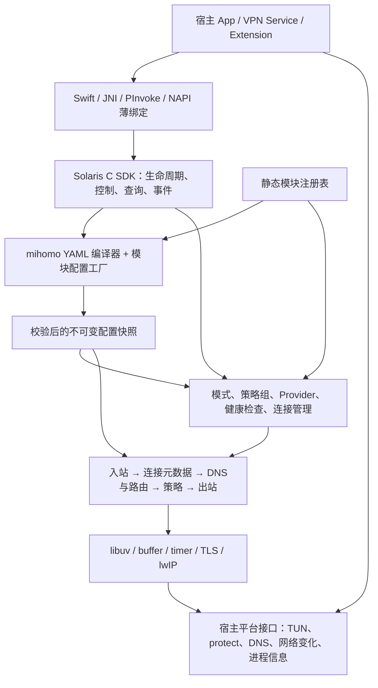

> 历史归档（2026-11-03）：原路径 `docs/MIHOMO_LIBRARY_DESIGN.md`。本文件仅供追溯；当前开发依据见 [开发文档入口](../../README.md)。正文保留归档时状态，链接已按归档位置调整。

# Solaris Core：兼容 mihomo 配置的 C 内核库设计草案

状态：全新开发的设计提案，尚未实施。日期：2026-11-03。以协议扩展为框架验收目标，不承担原实现的接口兼容责任。

## 1. 目标与边界

全新开发 Solaris Core：一个可嵌入、框架化的 C 代理内核。现有源码提供可复用的协议、算法和工程经验，新架构、目录、配置模型与宿主接口独立定义。公开配置兼容 mihomo YAML；宿主通过 C 接口管理内核，通过平台回调提供 VPN、网络和系统能力。产品形态参考 Herta-Network/libclash。

项目自有命名统一使用 `solaris`：函数与类型采用 `solaris_`，宏采用 `SOLARIS_`，公开头文件位于 `include/solaris/`。移除 `aproxy` 名称、路径、构建变量与导出符号，不设置旧名称别名、包装层或兼容头文件。

兼容目标是 mihomo 配置语义与相应协议的网络行为。原项目的 schema v2、ABI 版本、函数表、结构体布局、宿主接口及构建产物命名均不构成约束；开发阶段可直接删除或重新设计。新 SDK 采用普通 C 函数与 opaque handle，不引入为原接口服务的版本协商或转换层。

架构目标同时包括：新增可由 stream/datagram 表达的协议时，只增加协议模块、注册/构建声明及测试，不在 engine、router、TUN、策略组或宿主 SDK 中增加协议分支。协议配置解码、握手、会话复用和报文封装归属模块；框架提供共享运行时、拨号和资源生命周期服务。详细约定见 [框架架构与模块扩展契约](FRAMEWORK_ARCHITECTURE.md)。

本项目交付库、头文件、平台绑定和测试宿主。HTTP 控制器、Web 面板、独立守护进程不是本次设计的交付目标。libclash 是功能边界参考，不要求兼容其函数名、JSON 返回结构或二进制 ABI。

“C 内核”指自有运行时、配置编译、路由、DNS 和协议实现使用 C，发布产物不依赖 Go runtime。现有 BoringSSL 依赖本身包含 C++；本提案没有把所有第三方依赖都改成纯 C 的要求。

兼容基准优先固定为 libclash 当前使用的 Herta-Network/mihomo 提交 `9f121787bb563fe655d2789cbf6dbcc7ae19a0c9`。后续升级基准需要更新兼容测试，不能以浮动的“最新版 mihomo”作为验收条件。

## 2. 已验证的起点

Solaris Core 检查基线为 `f9ca89ac3cf13808463beac9b4130d6639ffb1c7`。

| 模块 | 现有实现参考 | 全新开发决策 |
| --- | --- | --- |
| 基础运行时 | C11、libuv、buffer/ring/pool、内存预算 | 按新的生命周期、取消与背压契约选择性复用实现 |
| 库入口 | 宿主回调、异步 operation、状态和统计 | 重新定义 `solaris_*` SDK；API facade 与 runtime 分离 |
| 入站 | SOCKS5、fd/packet callback TUN、lwIP TCP relay | 按统一 inbound/flow 接口重新组织；增加 HTTP/mixed 和多入站 |
| 出站 | Direct、Block、AnyTLS、Shadowsocks AEAD/2022、VLESS | 建立独立 adapter 模块，复用通过验证的 codec 与算法，通过 registry 创建 |
| 安全与传输 | TLS、REALITY、ECH、Vision、VLESS encryption、XUDP/UoT；底层 XHTTP | 逐项接通 YAML→运行时；不把有源码视为完成兼容 |
| 路由 | 域名、后缀、CIDR、GeoIP、Geosite、多 profile | 复用数据结构，重做 mihomo 选路语义 |
| 策略组 | 底层 round-robin，engine 未提供完整组配置入口 | 建立独立的嵌套策略图和健康检查系统 |
| DNS | 系统 getaddrinfo、缓存与请求合并 | 扩展成可配置的 DNS 子系统 |
| 配置 | 私有对象树，要求恰好一个 inbound | 直接采用 YAML 编译器 + 模块配置解码/校验 + 新内部模型；删除原私有配置入口 |
| 测试 | 一个接口 smoke C 文件，无仓库 CI workflow | 建立新 SDK/框架测试；协议样本以独立对端和 mihomo 为参照 |

以下是原实现的观察结果，用于确定复用范围，不是新架构的兼容要求：

- 当前 router 使用后添加规则优先；mihomo 从前向后匹配，而且 UDP 命中不支持 UDP 的策略时可能继续匹配。不能仅把 YAML 翻译成现有规则列表。
- `engine.c` 构造 VLESS 时没有设置 `config.xhttp`。XHTTP 底层代码存在，但原 engine 入口不可达；底层 HTTP/3 配置也明确返回 unsupported。
- `reload()` 先清理旧运行实例再启动新实例；这不是候选配置失败后自动保留原运行实例的事务式更新。
- `select_node()` 成功不等于远端握手成功。例如 VLESS 的 connect 路径最终可以只返回 Direct 的本地初始化成功。选中状态、拨号状态和健康状态必须分别表达。
- lwIP 使用 `NO_SYS=1`，初始化状态是进程级全局；动态内存预算也是全局。当前不能承诺多个 TUN engine 并行隔离运行。
- 框架已有 vtable，但 engine/library 仍逐协议构造对象；UoT 封装分散在 TUN UDP relay 与 SOCKS5 inbound；共用 TLS 的连接接口仍为 `anytls_tls_client_*`。需要把这些协议依赖收回 adapter 与共享 transport，而非仅按目录搬迁。
- UDP 核对和本地探针确认：TUN 原实现按五元组分别创建出站通道，仅支持 IPv4 UDP；SOCKS5 UDP 固定走 UoT，Direct 不交付零长度回包。新框架需要独立 association、目的映射和回复端点，详见 [UDP / NAT 设计](UDP_NAT_DESIGN.md)。

本次本机检查：macOS arm64 上 `xmake f -y -m debug` 成功，C 源码和 `libcore.a` 生成成功；`xmake -y -b abi_smoke` 在最终链接时出现 libuv 未定义符号。额外显式链接本次构建的 `libuv.a` 后，现有 ABI smoke 运行成功。这定位了构建依赖打包问题，不代表正常 SDK 构建通过，也不代表协议互通或真机 VPN 已验证。

这份构建记录只描述原实现。新项目直接建立自己的构建与消费测试，不以修复原 SDK 或保持原 smoke 的 API 调用为前置条件。

## 3. 库的分层

YAML 只在配置阶段出现。热路径使用 C 结构体、编译后的索引和对象句柄，不查询 YAML/JSON 树。配置编译器直接生成 Solaris 的内部模型，内部配置不作为需要兼容的公开序列化格式。

运行时只面向 `outbound`、`stream`、`datagram` 等契约。配置中的协议类型通过 registry 找到模块 descriptor；模块把自己的字段编译为私有、不可变的配置对象，再通过 factory 创建实例。协议列表、capability 和构建裁剪信息从 descriptor 汇总，避免 engine 维护另一份协议名单。网络资源经共享 dialer/socket service 创建，统一应用 DNS、socket protect、接口选择、超时和取消。

公开调用从 `solaris_engine_create`、YAML 配置编译、启动/停止和通用控制操作开始设计。SDK 不提供原项目的 get-api 函数表或逐协议构造函数；内部模块 vtable 服务于实现解耦，不成为宿主 ABI。

## 4. 参考 libclash 的功能映射

| libclash 中的功能 | 新库的接口职责 |
| --- | --- |
| init / reset / load | create、validate/prepare YAML、apply、start、stop、destroy |
| setup_config / override | 显式宿主选项与配置覆盖；返回实际生效值和诊断 |
| start_tun / stop_tun | attach/detach 宿主 TUN fd 或 packet channel |
| start_http / stop_http | 配置并管理 HTTP/SOCKS/mixed 代理入站；这不同于 HTTP 控制器 |
| set_mode | rule/global/direct 模式 |
| query_group(s) / patch_selector | 策略组快照、枚举、选择节点 |
| health_check / test_proxy_delay | 可取消的异步测延迟/健康检查任务 |
| query_providers / update_provider | Provider 快照与事务式刷新 |
| query_traffic / query_connection_count | 独立的 uint64 上传/下载字节数、速率和连接快照 |
| close_all_connections | 按 ID 或全部关闭连接；定义对现有 UDP 会话的影响 |
| update_dns | 网络变化通知、系统 DNS 更新和缓存失效策略 |
| socket protect / query UID | 带结果的保护回调和可选连接归属查询 |
| subscribe_logcat | 有界日志/事件订阅，宿主决定如何投递到 UI 线程 |
| GC 与 Go 内存设置 | 用内存预算、空闲缓存回收和内存统计表达 C 运行时能力 |

主 API 使用 opaque handle、固定宽度整数、带长度的字符串和清晰的所有权约定。状态查询优先返回受控生命周期的快照；JSON 序列化可以是绑定层的便利功能。libclash 的 packed traffic 编码和全局 last-error 不进入新接口；不添加仅为兼容原项目而存在的版本字段和保留槽位。

配置 API 应同时接受内存中的 YAML 字节与文件路径。内存入口需要显式 base directory，用于解析相对的 provider、证书和 Geo 文件路径。配置校验默认不下载远程资源；解析成功、资源就绪和可以运行是三个不同状态。

## 5. 配置兼容契约

配置流水线：

`YAML → 语法树与源位置 → mihomo 默认值/别名归一化 → 引用解析 → 能力校验 → 资源准备 → 不可变快照 → 提交`

配置范围覆盖 `proxies`、`proxy-groups`、`rules`、`mode`、基础监听设置、`dns`、`hosts`、`tun`、`sniffer`、`proxy-providers`、`rule-providers` 和必要的 `profile` 持久化行为，按里程碑逐项兑现。

不能仅凭字段名相同宣称兼容。每项能力需要记录：配置字段、默认值、运行行为、所需平台能力、测试用例和支持状态。状态分为完整支持、限定条件支持、宿主管理、不支持。

- YAML 锚点、别名、merge key、标量类型转换、重复 key 和错误位置均用基准样本核对。配置深度、别名展开量、字符串和节点数量有明确上限。
- 未实现的协议、规则、DNS 模式或影响转发的字段必须给出带配置路径的错误，不能悄悄退回 Direct。
- 用作 YAML 模板的扩展节点可以保留或忽略；遵循基准行为并给出必要诊断，不能简单拒绝所有未知顶层 key。
- `external-controller`、`external-ui`、`secret` 等进程控制字段可解析并标记为库模式不执行，不因此创建控制端口。宿主能够读取适配报告。
- 宿主对 TUN、监听地址、工作目录的覆盖需要显式声明优先级。返回“配置请求值、宿主覆盖值、最终值”，避免隐含的平台改写。
- `tun.stack` 是特别的兼容边界：现有 lwIP 不能直接冒充 mihomo 的 system/gvisor/mixed。未支持的栈必须报错，或由宿主显式选择库的实际后端并报告覆盖。
- 核心输入是 mihomo YAML 和 provider payload。分享链接、订阅转换及 App profile 管理不应成为各平台各写一遍核心配置语义的理由；需要时以独立导入模块复用。

## 6. 数据面与控制面的关键改造

### 6.1 连接元数据和路由

新增统一 flow metadata：源/目的 IP 与端口、网络类型、入站身份、原始域名、嗅探域名、DNS/Fake-IP 关联、可选 UID/进程信息。保留原始目的地址与改写后的目的地址，明确 sniff 的路由与目的地改写行为。

先实现按规则顺序执行、语义清晰的参考解释器，再增加域名/CIDR/Geo 索引。优化后仍需保留规则顺序、延迟 DNS 查询、`no-resolve`、UDP 能力过滤和逻辑组合的行为；不能简单地对所有索引结果取最小序号就认为等价。

基础规则后补齐 RULE-SET、逻辑规则、源地址/端口、进程与 UID 等能力。依赖平台查询的规则通过 capability 明确可用性。

### 6.2 策略图

为出站节点和策略组建立稳定 ID 与名称映射，支持组嵌套并检测循环。按 select → url-test/fallback → load-balance 的顺序交付；relay/dialer-proxy 单独定义链式拨号语义。

策略组实现相同的 outbound 数据面接口，控制能力通过独立的 group 接口提供。router 选择的是 outbound 句柄，不需要知道目标是节点还是组；通用统计、健康检查和连接追踪包装同一接口。

健康检查拥有超时、并发上限、取消、历史结果与懒执行策略。TCP/UDP 能力依据最终选中的成员判断，不能要求组内所有协议使用同一种 UoT/原生 UDP 传输。既有连接保留已选定出站，新连接读取当前组选择；是否关闭旧连接是显式控制操作。

UDP 中的“既有连接”指 association，未必是一个目的五元组。兼容模式在 association 首次有效报文选路并固定最终出站；后续多目的数据报复用该计划。新策略/节点选择影响新 association，显式关闭才终止既有 association。

### 6.3 DNS 与 Fake-IP

DNS 是路由和 TUN 的共同子系统。分层实现 DNS 报文解析、UDP/TCP 上游、hosts/cache、nameserver policy、DoH/DoT、Fake-IP、fallback 与独立的代理服务器域名解析路径。DoQ/HTTP3 随 QUIC 后端交付。

Fake-IP 需要双向映射、排除规则、回收策略和可选持久化。网络切换后更新系统 DNS 并按解析器代际失效相关缓存；不得顺带丢弃仍被连接使用的 Fake-IP 映射。

UDP 目的映射持有 Fake-IP 租约，并区分原始目标、实际 peer 与应回写给客户端的地址。多原目标到同实际端点的歧义需隔离处理；备用远端源地址不能被统一改写成首包目标。

代理服务器域名解析与经代理访问的 DNS 上游必须避免依赖环。系统解析入口也要经过宿主网络策略，不能仅保护数据 socket 却遗漏 DNS 路径。

### 6.4 Provider 与资源

Provider 模块负责定时调度、解析校验、过滤、快照发布和更新结果；资源 I/O 层负责本地文件/HTTP(S) 获取。宿主可接管特殊 URI 与平台容器访问，普通 provider 获取可通过库的可选资源后端完成。

下载到候选文件，完成大小/格式/引用校验后原子发布；失败保留旧快照。区分 proxy-provider、rule-provider、Geo 数据与 App 主订阅的生命周期。rule-provider 的 classical/domain/ipcidr 行为及 yaml/text/mrs 格式逐项登记兼容性。

### 6.5 传输与协议

抽象 transport 与代理协议，统一 stream 和 datagram 的打开、读写、半关闭、背压、取消、完成回调和释放约定。所有 UDP 出站向上提供同一 datagram 接口，UoT/XUDP 等封装由 adapter 内部调用共享 codec；TUN 与 SOCKS5 不再处理出站封装。TLS/WS/gRPC/XHTTP 提供可复用的 transport factory，AnyTLS/QUIC 等复用连接由 session owner 管理。只允许模块声明兼容的组合，不承诺所有 transport 可以任意堆叠。

在框架验收中用新的 SOCKS5 出站验证扩展成本，再扩展 HTTP 出站、Trojan、VMess 与需要的 WS/gRPC/HTTP Upgrade；QUIC 系列单独做后端验证。

TLS 指纹、ALPN、REALITY、ECH、Mux 和 UDP 封装均作为独立的兼容项测试。能完成普通 TLS 握手不代表支持配置中的任意 client-fingerprint。密码算法使用既有密码库，不让 AI 重新发明实现。

## 7. C 运行时、SDK 与更新模型

- 采用一个 engine 管理 N 个 I/O worker，每个 worker 一个 libuv loop。每个连接、UDP association 和共享 session 固定归属一个 owner；不同 owner 并行。通过有界命令队列处理宿主请求，文件读取和配置编译放入后台任务。单 worker 是受支持的运行配置，多核所有权与消息边界从框架阶段建立，详见 [运行时与多核并行设计](RUNTIME_CONCURRENCY_DESIGN.md)。
- 生命周期变更串行执行，异步任务使用 operation ID、取消令牌和 generation。每个接受的操作有且仅有一次最终结果。
- 输入数据在 API 返回前复制，或通过独立的 owned handle 转移所有权。借用数据只在指定回调范围有效；跨 ABI 分配的内存由对应库释放接口回收。
- 事件/日志采用有界队列。数据包回调与控制事件分开；高流量时合并统计，防止宿主 UI 停顿造成无限积压。
- stop 先停止新任务与 packet admission，再取消/排空 I/O、protect 请求和回调，最后完成停止。宿主在停止屏障之后释放自己拥有的 TUN 和回调上下文。
- protect 请求需要明确失败、取消和迟到完成的处理；socket 在请求仍可能被宿主使用时不得被关闭后复用。不能依赖没有返回结果的 fire-and-forget 回调。
- destroy 从普通宿主线程调用；禁止在内核回调线程等待自己退出。新接口要检测此误用并返回明确状态。
- 新运行时的预算、平台策略和可变状态归属 engine 实例及其 worker。当前 lwIP 配置由独立 stack owner 串行管理，出站可经消息交给其他 worker；这只并行出站与协议处理，TCP 栈本身仍可能限速。真正并行的栈 backend 必须证明实例/队列隔离，不能让多 worker 直接并发访问原全局栈。
- 内存统计区分数据面受预算约束的内存、配置/索引、第三方库和进程总内存。预算不等于对整个进程 RSS 的硬保证。

配置更新采用 prepare/commit/retire：先校验候选快照并准备可准备的资源，失败不动旧配置；提交时新连接使用新配置，旧连接持有旧代所需对象直到结束。策略选择、provider 更新和主配置更新有各自的 revision，避免刷新 provider 重启整个 TUN。

端口重绑定、TUN 参数和网络路由等不能完全预创建的资源需要单独的变更计划与回滚步骤。库向宿主报告“可在线提交”或“需要宿主重启 TUN”，不承诺所有字段都无损热更新。

## 8. 平台职责与产物

| 平台 | 宿主职责 | 库产物与入口 |
| --- | --- | --- |
| Android | VPN 权限、VpnService、TUN fd、protect、网络/UID 信息 | `libsolaris.so` + C header；JNI/AAR 或 P/Invoke 薄绑定 |
| iOS/macOS | Network Extension、NEPacketTunnelFlow、系统 VPN 生命周期 | `Solaris.xcframework` + module map/Swift 包装；packet callback |
| Windows | Wintun、路由、DNS、接口选择与权限 | `solaris.dll` + header/import library；packet callback |
| Linux | TUN、路由/策略与权限 | `libsolaris.so` / `libsolaris.a`；宿主 fd 或 packet callback |
| OpenHarmony | VPN Extension、TUN、socket 保护和宿主事件循环 | `libsolaris.so` + header；N-API/宿主绑定，专用构建与设备验证 |

TUN fd 的默认契约定义为“宿主拥有、内核借用”。绑定层若需要转移所有权，必须在独立接口说明何时转移与失败时谁关闭。证书信任、网络变化和进程查询是平台适配层的明确能力，不能假定所有平台存在同一个证书文件路径或进程 API。

## 9. 实现顺序与验收

| 阶段 | 交付内容 | 必须通过的验收 |
| --- | --- | --- |
| M0：新工程基础 | Solaris 命名、目录与构建；新 C SDK/所有权契约；兼容清单和测试宿主 | 新库正常构建与安装消费；只有 Solaris 自有导出；无原接口兼容层；新 SDK 启停与失败清理 smoke 通过 |
| M1：框架成立 | registry、模块配置/factory、stream/datagram/dialer、UDP association/映射/回复端点、多 worker 所有权/mailbox、生命周期契约；实现基础 adapter 并补新 SOCKS5 出站 | 新协议仅改模块/注册构建清单/测试；engine/router/TUN/SDK 无协议分支变更；至少两 worker 的分派/关闭/代际测试、同源多目的 UDP 与协议互通通过 |
| M2：配置可用 | YAML 编译、配置诊断、新快照模型、基础首匹配规则、select、基础协议、SOCKS/HTTP/mixed 入站、模式/统计/连接 SDK | 同一基础 YAML 与参考内核选路一致；宿主能加载、选节点、查询与关闭连接 |
| M3：VPN 闭环 | DNS 基础与 policy、DoH/DoT、Fake-IP/UDP 回复恢复、双栈 TUN packet codec、DNS 接入、网络变化通知 | 受控 DNS 对端与 packet 测试通过；IPv6/空数据报/映射超时正确；Android/Apple 真机完成 TCP/UDP、断网恢复、反复启停 |
| M4：日常配置 | Proxy/rule provider、url-test/fallback/load-balance、Geo/rule-set、选择持久化与更新 | provider 更新失败保留旧配置；策略/规则样本与基准一致；更新期间现有流量行为符合契约 |
| M5：协议与平台扩展 | Trojan/VMess、额外传输、TLS 指纹能力；Windows/Linux/OpenHarmony 接入 | 独立实现对端互通，明确每个协议组合与平台的通过/未通过状态 |
| M6：高级能力与优化 | QUIC 系列、更多规则/链式代理、栈 backend 并行扩展、负载均衡与性能调优 | 在已有多 worker 正确性基线上比较吞吐、尾延迟、CPU、RSS和能耗；升级兼容矩阵 |

里程碑按全新项目的依赖关系安排，不以原接口兼容程度、生成代码量或协议名称数量衡量进度。M2 是首个宿主业务可用的库版本；M4 是日常配置兼容版本的目标，是否达到由配置样本覆盖决定，不在设计阶段宣称全量兼容。

## 10. AI 辅助开发方式

每个改动采用“行为契约 → 最小实现 → 独立验证”的闭环：

1. 从固定的 mihomo/libclash 基准提取配置样本、默认值和行为期望，写明不支持的组合。
2. 为该模块先写接口、状态机、所有权与失败路径；AI 在此边界内实现可单独审查的改动。新增 adapter 仅依赖框架服务与声明的共享组件，并运行统一的 adapter 契约测试；不得为通过一个协议的测试而把协议类型判断加回 engine/router/TUN。
3. 使用固定时钟、受控 DNS/HTTP/TCP/UDP 对端、可注入失败，复现超时、背压、半关闭、取消和更新竞争。
4. 差分测试比较配置归一化、路由结果、策略选择、DNS/Fake-IP 与宿主可观察行为；对输出中的时间、ID 等非确定性字段归一化。
5. 协议采用独立实现互通，解析器和帧处理采用 fuzz，C 生命周期用 ASan/UBSan 与适用的并发检测；性能结论来自同条件 A/B 测量。

参考 Go 内核仅在测试工具链或独立参考进程中运行，不成为发布库的数据面依赖。避免让同一份新 C 实现同时生成全部测试期望，否则差分验证会失去独立性。

## 11. 参考依据

- [libclash README](https://github.com/Herta-Network/libclash/blob/main/README.md)、[C 导出入口](https://github.com/Herta-Network/libclash/blob/main/cmd/main.go)、[API 文档](https://github.com/Herta-Network/libclash/blob/main/docs/api.md)、[使用文档](https://github.com/Herta-Network/libclash/blob/main/docs/usage.md)：本提案参考其宿主集成与功能分组，不复制其 ABI。
- [libclash 的固定 mihomo 依赖](https://github.com/Herta-Network/libclash/blob/main/go.mod)：本次兼容基准的来源；上述 main 链接反映本次读取状态，M0 需要记录对应不可变提交和测试产物。
- [基准配置模型](https://github.com/Herta-Network/mihomo/blob/9f121787bb563fe655d2789cbf6dbcc7ae19a0c9/config/config.go)、[规则匹配](https://github.com/Herta-Network/mihomo/blob/9f121787bb563fe655d2789cbf6dbcc7ae19a0c9/tunnel/tunnel.go)、[策略组解析](https://github.com/Herta-Network/mihomo/blob/9f121787bb563fe655d2789cbf6dbcc7ae19a0c9/adapter/outboundgroup/parser.go)。
- [mihomo 出站与拨号契约](https://github.com/Herta-Network/mihomo/blob/9f121787bb563fe655d2789cbf6dbcc7ae19a0c9/constant/adapters.go)、[公共 adapter 能力](https://github.com/Herta-Network/mihomo/blob/9f121787bb563fe655d2789cbf6dbcc7ae19a0c9/adapter/outbound/base.go)、[协议工厂入口](https://github.com/Herta-Network/mihomo/blob/9f121787bb563fe655d2789cbf6dbcc7ae19a0c9/adapter/parser.go)：参考其扩展边界；C 实现采用组合与显式函数表。
- [官方规则说明](https://github.com/MetaCubeX/Meta-Docs/blob/main/docs/config/rules/index.md)、[官方 YAML 语法说明](https://github.com/MetaCubeX/Meta-Docs/blob/main/docs/handbook/syntax.md)：用于核对配置行为；与固定基准的差异另行登记。
- 本仓库原实现参考：[原嵌入说明](EMBEDDING.md)、[engine](https://github.com/Anti-EntropyTech/Solaris-Core/blob/f9ca89ac3cf13808463beac9b4130d6639ffb1c7/src/engine.c)、[router](https://github.com/Anti-EntropyTech/Solaris-Core/blob/f9ca89ac3cf13808463beac9b4130d6639ffb1c7/src/framework/router.c)、[DNS](https://github.com/Anti-EntropyTech/Solaris-Core/blob/f9ca89ac3cf13808463beac9b4130d6639ffb1c7/src/framework/dns.c)、[TCP relay](https://github.com/Anti-EntropyTech/Solaris-Core/blob/f9ca89ac3cf13808463beac9b4130d6639ffb1c7/src/framework/packet_tcp_relay.c)、[原构建入口](https://github.com/Anti-EntropyTech/Solaris-Core/blob/f9ca89ac3cf13808463beac9b4130d6639ffb1c7/xmake.lua)。这些文件用于提取实现经验，不约束新 SDK、命名或配置模型。
