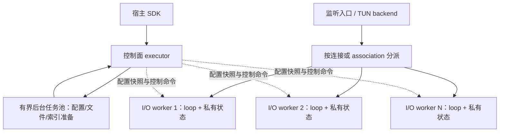

> 历史归档（2026-11-03）：原路径 `docs/RUNTIME_CONCURRENCY_DESIGN.md`。本文件仅供追溯；当前开发依据见 [开发文档入口](../../README.md)。正文保留归档时状态，链接已按归档位置调整。

# Solaris 运行时与多核并行设计

日期：2026-11-03。状态：架构提案；已核对原实现与 libuv 官方文档，尚未实现或测量新运行时。

## 1. 判断

libuv 的一个 event loop 由一个线程执行，但同一进程可以在不同线程运行多个 loop。因此，Solaris 可以继续使用 libuv，同时通过多个 I/O worker 利用多核。

当前原实现每个 engine 创建一个线程和一个 `uv_loop_t`。网络回调、转发、TLS、Shadowsocks 加解密及 QUIC Initial sniff 等工作主要在该 loop 内执行；它存在单个数据面线程的 CPU 上限。异步 I/O 能让许多等待网络的连接共存，不会自动把回调内的 CPU 工作分配到其他核。

高吞吐、高包率、大量握手或复杂匹配可能使一个核饱和，进而增加排队和尾延迟。是否已经达到这个上限需要测量；不能仅凭使用 C、libuv 或多线程就承诺具体吞吐。

## 2. libuv 的两个线程概念

| 机制 | 实际作用 | 对 Solaris 的意义 |
| --- | --- | --- |
| Event loop | 每个 loop 在自己的线程运行网络 I/O 和回调；普通 handle/loop 操作需要遵守线程所有权 | 一个 worker 拥有一个 loop，不同 worker 并行处理不同连接 |
| libuv 全局线程池 | 服务于异步文件操作、getaddrinfo/getnameinfo 和显式提交的 work | DNS/文件可使用它；它不会自动处理代理加解密或拆分网络回调 |

`UV_THREADPOOL_SIZE` 调整后一种机制，不改变某个网络连接属于哪个 loop。它也是进程级设置，嵌入式库不应把修改宿主环境变量作为提高数据面并行度的实现方式。

## 3. 新架构：每个对象单 owner，多个 owner 并行

这里的控制面 executor 是一个逻辑所有者：平台资源预算允许时使用独立线程，也可以绑定指定 worker；不能在它与数据面共用线程时执行耗时编译或阻塞任务。

基本规则：

- 一个 engine 管理 N 个 `solaris_io_worker_t`，每个 worker 拥有自己的 loop、连接表、UDP association 表、timer、可变协议实例与 session pool。
- 一个连接、association、TLS/QUIC/AnyTLS session 始终归属一个 owner executor。普通路径中不跨 worker 移动活动对象，不让多个线程同时操作同一个 libuv handle 或协议状态机。
- adapter 只使用注入的 `solaris_executor_t` 和 services，不自行决定线程数量；新增协议仍只实现公共模块契约。
- 配置、路由索引与 Geo 编译结果以不可变快照共享。可变匹配上下文、连接序号、重放窗口、缓存和 buffer pool 由明确的 worker/service owner 管理。
- selector 选择与健康结果由控制面发布一致快照。load-balance 等需要全局选择语义的策略使用明确的协调状态，不能因为新增 worker 就悄悄变成 N 套不一致的轮询计数。
- 流量统计先在各 worker 聚合，再生成宿主快照。内存预算分层预留，避免每个数据包都竞争同一个全局锁或频繁写同一缓存行。

worker 数量是宿主运行参数，不添加到 mihomo YAML 的公共语义中。支持单 worker 运行和显式配置 N；自动策略在平台负载测量后确定，不默认把所有 CPU 核全部占满。

## 4. 分派粒度必须匹配协议状态

### 4.1 TCP

在连接进入数据面时分配 worker，同一连接的路由、代理状态、加解密和出站 I/O 尽量留在该 worker。监听器可以由平台支持的多监听机制分担，或通过明确的 accept/handoff backend 把新连接所有权交给 worker；这不能简化成跨线程调用 `uv_accept` 或搬动一个正在运行的 handle。

多条连接可以分布到多个核。单条大 TCP 流仍主要受其 owner 的处理能力约束，不会因为设置 N 个 worker 自动获得 N 倍吞吐。

### 4.2 UDP

用 [UDP / NAT 设计](UDP_NAT_DESIGN.md) 定义的 association key 选择 worker：包含 engine/inbound 命名空间、逻辑客户端身份和源端点，不按目的五元组把同一个 association 拆到不同 worker。

这样，同源 A/B 两个目标仍由同一 association 和本地绑定管理，保持端口复用、发送顺序、DNAT 与 Fake-IP 租约语义。不同 association 可以并行。

启动时固定分片方案，显式记录 owner；不在运行中直接改变 `hash % worker_count`。调整 worker 数需要排空、代际映射或显式重建，不能让存量 association 瞬间出现在另一张表中。内核提供的 UDP listener 分流结果也不能取代 association owner 检查。

### 4.3 Mux / HTTP2 / AnyTLS / QUIC

共享底层连接的子流属于同一个 session owner。每个 worker 可拥有自己的会话池，以多个底层 session 分担负载；总 idle/session 数受 engine 预算控制，不能将配置中的池上限直接放大 N 倍。

需要跨 worker 复用已有 session 时通过消息提交请求，由 session owner 操作底层连接。不能让两个 worker 同时读写一个 SSL、QUIC 或 Mux 状态机。单个共享 session 仍可能是热点，基准必须包含这种负载。

## 5. 后台任务与加解密

配置解析、资源读取、Geo/rule-set 编译等准备工作进入有界后台任务池，完成结果通过消息回到 owner。对 libuv 原有 DNS/文件线程池也限制并发，避免无上限地堆积任务。

初始的数据面加解密随连接分布到多个 I/O worker，直接利用多核。不能默认把每个小包都投递到线程池：排队、唤醒、引用转移和重新排序可能超过计算收益。

只有 profiling 证明必要时，才对能独立计算的任务增加专用 CPU executor。任务必须持有独立输入、只读参数、输出 buffer 和取消/代际标识；nonce 分配、重放状态和提交顺序仍由 owner 管理。禁止把同一 SSL 对象的握手/读写任意并发提交到任务池。

## 6. 跨线程通信与关闭

worker 之间使用有界 mailbox 传递命令和有所有权的 buffer 引用，接收 worker 执行对象操作。队列使用自身正确的同步机制，`uv_async_send()` 只负责唤醒；它可能合并多次通知，不能把一次回调当成只对应一条消息。

每次 drain 有工作预算，剩余消息按通知协议继续调度，避免占满整个 event loop。控制消息、释放通知与数据消息需要保留可完成的容量；背压不能阻断停止流程或内存回收。

关闭顺序是：停止新任务/入站分派，向各 owner 发停止命令，取消其后台任务，排空完成与释放消息，等待 worker 屏障，再回收对象和线程。迟到结果按 generation 丢弃或清理，不访问已经销毁的 engine。

## 7. 当前 lwIP 是额外的约束

原仓库配置 `NO_SYS=1`、`SYS_LIGHTWEIGHT_PROT=0`、`LWIP_TCPIP_CORE_LOCKING=0`，且使用进程级初始化状态。不能把这一套 lwIP 状态直接暴露给多个 I/O worker 并行操作；增加全局锁也不会使 TCP 栈本身并行。

将 TUN backend 与出站 worker 分离，明确两种能力：

1. **串行栈 backend**：一个 stack executor 拥有 lwIP 和 TUN TCP 状态，向出站 worker 交付有序数据，返回结果再投递回栈。加解密和出站网络可并行，但 TCP 栈、入口分派与回复写入仍可能成为瓶颈。UDP association 可以通过独立路径分片。
2. **可分片栈 backend**：提供实际隔离的多实例或多队列/多 owner 能力，按 TCP 连接分片处理。必须经实现和线程检测证明隔离，不能给现有 lwIP 多传一个 context 就宣称可用。

先以明确的串行栈适配边界实现正确性，尽早测出它的吞吐和 CPU 占比，再决定栈 backend 的演进。所有 backend 的可变状态、宿主 packet callback 线程约束以及输出批次所有权都要显式声明。

## 8. 开发与性能验收

多 worker 的对象所有权和消息边界属于 M1 框架工作。可先跑一个 worker 验证功能，但 M1 完成前要在至少两个 I/O worker 上验证 TCP/UDP 分派、取消、关闭、配置代际和 session 归属；不能把多核支持完全留到最后再改框架。

性能测量包含：

| 负载 | 重点观察 |
| --- | --- |
| Direct 单连接/多连接 | 单流上限与多 worker 聚合吞吐的区别 |
| SS/VLESS/TLS 多连接 | 加解密/握手是否分散到多个核 |
| 多 association UDP 与单 association 大流量 | 关联分片是否均衡，端口复用与顺序是否稳定 |
| AnyTLS/HTTP2/QUIC Mux | 单 session 热点与多 session 分布 |
| TUN TCP / TUN UDP | stack、入口分派、输出写入是否串行限速 |
| 配置/provider 更新叠加转发 | 重载是否造成 loop 卡顿或尾延迟突增 |

同一设备、流量、网络和电源条件下比较 1/2/4 个 worker，记录每线程 CPU、吞吐、包率、p50/p95/p99 延迟、loop lag、mailbox 深度、丢包、RSS/峰值内存和能耗。线程数量、池预算与默认策略以数据决定，不承诺线性扩展。

本次只进行了源码与文档核对，没有运行多核吞吐基准。

## 9. 依据

- [libuv design overview](https://docs.libuv.org/en/v1.x/design.html)：一个 loop 对应一个线程，可多 loop 并行；网络 I/O 与线程池职责不同。
- [libuv thread pool](https://docs.libuv.org/en/v1.x/threadpool.html)：全局池和 `uv_queue_work` 的执行/完成模型。
- [libuv async handle](https://docs.libuv.org/en/v1.x/async.html)：跨线程唤醒和通知合并。具体内存序约定随版本核对，mailbox 不依赖唤醒次数表达消息。
- 原实现：[engine](https://github.com/Anti-EntropyTech/Solaris-Core/blob/f9ca89ac3cf13808463beac9b4130d6639ffb1c7/src/engine.c)、[TLS](https://github.com/Anti-EntropyTech/Solaris-Core/blob/f9ca89ac3cf13808463beac9b4130d6639ffb1c7/src/tls_uv.c)、[Shadowsocks](https://github.com/Anti-EntropyTech/Solaris-Core/blob/f9ca89ac3cf13808463beac9b4130d6639ffb1c7/src/shadowsocks_outbound.c)、[DNS](https://github.com/Anti-EntropyTech/Solaris-Core/blob/f9ca89ac3cf13808463beac9b4130d6639ffb1c7/src/framework/dns.c)、[lwIP 配置](https://github.com/Anti-EntropyTech/Solaris-Core/blob/f9ca89ac3cf13808463beac9b4130d6639ffb1c7/cmake/mobile/lwip/lwipopts.h)、[TCP relay](https://github.com/Anti-EntropyTech/Solaris-Core/blob/f9ca89ac3cf13808463beac9b4130d6639ffb1c7/src/framework/packet_tcp_relay.c)。
