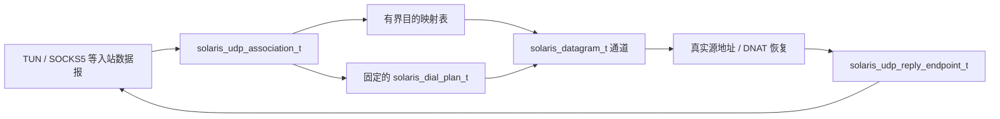

> 历史归档（2026-11-03）：原路径 `docs/UDP_NAT_DESIGN.md`。本文件仅供追溯；当前开发依据见 [开发文档入口](../../README.md)。正文保留归档时状态，链接已按归档位置调整。

# Solaris UDP / NAT 设计核对与调整

日期：2026-11-03。状态：源码核对、本地探针与新架构提案；尚未实现新的 UDP 子系统。

## 1. 结论

UDP 需要调整到框架层，尤其是会话身份、出站复用、回复路径和地址映射。保留已有的有界缓冲、批量收发、协议 codec 和真实回包源地址传递；重新定义 TUN 与 SOCKS5 共享的 UDP association 服务。

新的结构是：`入站数据报 → UDP association → 目的映射 → 固定出站计划 → datagram 通道 → 回复地址恢复 → 入站回复端点`。

此前草案里“不同目的地按路由上下文创建 flow”的表述不够精确。核对的 mihomo 通用 UDP 路径在 association 首次建立时选路，后续目的地复用该出站；Solaris 的兼容行为应明确遵循这一边界。五元组可以标识子流和统计，不应自动等同于一个独占 socket。

## 2. 核对范围

- mihomo：libclash 所固定的 Herta-Network/mihomo `9f121787bb563fe655d2789cbf6dbcc7ae19a0c9`。
- TUN 依赖：上述提交的 `github.com/metacubex/sing-tun v0.4.28`；检查 system、gvisor/mixed 和 mipstack 的 UDP 转发入口。
- 本仓库原实现：`f9ca89ac3cf13808463beac9b4130d6639ffb1c7`，主要检查 packet session、TUN UDP relay、SOCKS5 inbound、Direct 与协议出站。
- 运行证据：macOS arm64，本地 UDP 对端和手工构造的有效 IPv4/IPv6 UDP 包，直接调用现有 packet session / relay。未使用系统 VPN，未验证公网 NAT 或远端代理服务器。

## 3. mihomo 实际怎样处理 UDP

### 3.1 入站提供 association 身份和回复能力

`constant.NewPacketAdapter()` 用 `packet.LocalAddr().String()` 生成通用 NAT key。这个值不一定只是普通源地址：

- TUN 的 `ListenerHandler.NewPacket()` 保留源地址，目标地址不进入通用 key。
- 一些通过 `NewPacketConnection()` 接入的协议为每个 packet connection 生成 UUID，作为自定义 key。
- 非 TUN 的 sing handler 可把 handler ID 与连接 key 组合，区分入站上下文。
- 普通 SOCKS UDP listener 使用客户端 UDP 源地址。

所以要借鉴“入站定义逻辑会话身份”，不能把实现概括成所有入口都只按源 IP/端口处理。Solaris 还应显式加入 engine/inbound 命名空间，避免不同监听器上的同名源地址互相覆盖。

### 3.2 首包创建 sender 和出站，后续包排队复用

`tunnel.HandleUDPPacket()` 按 key 分配 UDP worker，队列满则丢包。`handleUDPConn()` 对 NAT table 执行 get-or-create，首次创建 sender 后完成 sniff、metadata 预处理、选路和 `ListenPacketContext()`。

每个 sender 有容量 128 的队列，按顺序发送，并负责归还 packet buffer。后续报文进入已有 sender，进行目标解析/映射后调用同一个 `PacketConn.WriteTo()`；不会为每个目的地址再次执行完整的 `resolveMetadata()` 选路。

这意味着，同一 association 先访问匹配 Direct 的目标 A，再访问本来会匹配 Proxy 的目标 B，B 在该 association 存续期间仍可能走首次选定的 Direct。这是需要用兼容测试固定的可观察语义，不能不加说明地改成逐目的地址选路。

### 3.3 SNAT 会话表与目的地址恢复是两件事

`component/nat.Table` 管理 key → PacketSender，并附带 TProxy 使用的本地回复 socket/同步对象。它不是一张所有平台都共用的完整 IP 包五元组改写表。

`packetSender` 内另有 `originToTarget` 与 `targetToOrigin`，记录原目标到实际目标的关系，用于 Fake-IP、hosts 和 DNS 解析后的回复恢复。入站提供 `WriteBack(payload, source)`，TUN 生成 IP 包、SOCKS5 添加 SOCKS UDP 头；共用 UDP 层不处理入站协议格式。

`WriteBackProxy` 随后续包更新回复对象，用于避免一直持有失效的初始回复通道。Solaris 应保留这一能力，同时通过引用与代际校验管理 C 对象生命周期。

### 3.4 回包需要保留真实源地址

`handleUDPToLocal()` 从 `PacketConn` 取得实际远端地址，再对真正发生过地址转换的目标进行恢复，最后交给 `WriteBack`。这允许同一通道收到不同远端 IP/端口的包，对 STUN 等行为有意义。

映射复用与入站过滤是独立维度：同一个本地 socket 可以按不同策略接受远端报文；是否复用源端口不能独自说明过滤行为。这一区分见 [RFC 4787](https://www.rfc-editor.org/rfc/rfc4787.html#section-4.1)。

### 3.5 不能直接照搬的细节

- 此基准的 `targetToOrigin` 以实际 IP 为 key，多个原始地址映射到同一 IP 时不能表达所有反向关系。Solaris 需要把端口、association、地址族和歧义处理纳入设计。
- 通用 tunnel 的 UDP idle deadline 为 60 秒；TUN 配置的默认值与传给 stack 的值为 300 秒。这些是不同层的设置，不能仅凭 YAML 字段推断实际通道存续时间。
- `endpoint-independent-nat` 会被传入 StackOptions，但在固定依赖 v0.4.28 的 Go 源码中，该字段除声明外未发现读取。已检查的 TUN UDP 入口直接把源地址交给通用 handler。不能据此声称开关两个取值已经实现不同映射行为。
- 同一 sender 内的同步 ResolveUDP 可能阻塞后续发送；这不能照搬成 C I/O loop 上的阻塞解析。

Solaris 配置应兑现明确的行为。`tun.udp-timeout` 按秒控制实际 UDP association 的 idle deadline，默认采用文档约定的 300 秒；不复刻基准中另一个固定 60 秒 deadline 抢先关掉通道的现象。NAT 开关是否适用必须按实际 backend 能力报告，不接受字段却隐藏无效状态。这些与固定实现的差异需要记录为明确修正。

## 4. 当前 Solaris 原实现的差异

| 项目 | 现有代码行为 | 新框架决策 |
| --- | --- | --- |
| TUN 会话键 | `packet_session` 使用地址族、协议、源/目的 IP 与端口的完整 key | 五元组用于子流；UDP association 由入站身份和源端点确定 |
| 出站 socket | 每个 TUN UDP session 单独 open packet flow；Direct 再单独 bind 临时 UDP 端口 | 同一 association 在相同地址族/网络绑定内复用出站通道 |
| SOCKS5 UDP | 单个 TCP association 上固定调用 UoT stream 路径 | 与 TUN 共用 datagram/association 服务，由选定 adapter 实现 UDP 封装 |
| IPv6 UDP | `packet_udp_relay_on_session()` 明确只允许 IPv4，回复生成器也只有 IPv4 | 完整的双栈 packet codec 和回复端点 |
| 域名 UDP | Direct 只缓存初始域名的解析结果；新域名不能直接复用其原接口 | 每个 association 内按目标维护有界解析/映射条目 |
| Fake-IP / DNAT | 没有用于回复恢复的通用目的映射层 | 与 DNS/Fake-IP 服务共享映射租约 |
| 回复源地址 | TUN 从 outbound 回调 source 构造回复，允许不同远端源端口 | 保留；只对已建立的 DNAT 关系做必要恢复 |
| 零长度数据报 | Direct 接收回调只处理 `nread > 0` | 将合法零长度报文与“没有数据的回调”区分 |
| 生命周期 | TUN 有 idle 扫描；SOCKS5 走 TCP association 的另一套关闭逻辑 | 一个共用状态机；入站关闭通知仍保留各自语义 |
| 性能 | 已有批量 UDP 收发、有界 pool、输入批次借用与预算回退 | 复用这些机制，调整其所有者与错误/完成契约 |

### 4.1 本地探针结果

探针向当前 TUN packet session/relay 注入同一虚拟源地址/端口的三包：A、B、A；A/B 是两个本地 UDP 对端。A 回正常数据、一个零长度数据报，并让第三个端口返回额外数据。另注入带 UDP 校验和的 IPv6 包。

| 观察 | 结果 |
| --- | --- |
| 对端收到数据 | A 两包，B 一包 |
| UDP relay session 数量 | 2 |
| 重复访问 A | 复用相同出口端口 |
| A 与 B | 使用不同出口端口 |
| 普通/第三方端口回复 | 交付 4 包，第三个端口的真实源端口保留 |
| 零长度回复 | 已由对端成功发出，未交付到回复 callback |
| IPv6 | 会话打开返回 unsupported；未进入 UDP 转发 |

探针及结果在本地忽略目录 `build-review/udp_nat_probe.c`、`build-review/udp_nat_probe.json`。它显式补链原构建遗漏的 libuv；这不是正常 SDK 打包通过的证明，也不是公网 STUN 测试。

结论是原实现无法保证同一源端点跨目标复用本地映射。不能仅据此给整条公网链路贴“对称 NAT”标签：上游路由器和代理服务器仍会影响公网观察结果。

## 5. Solaris 新 UDP 模型

### 5.1 四类对象

- `solaris_udp_association_t`：逻辑客户端、owner executor、有界队列、状态、固定路由/节点选择、超时与子通道的所有者。
- `solaris_udp_mapping_t`：原始目标、域名/嗅探信息、实际端点、Fake-IP 租约和回复恢复规则。它不是一个 socket。
- `solaris_datagram_t`：adapter 提供的收发通道，可以是 native UDP、UoT、XUDP、QUIC 或共享 session 的子通道。
- `solaris_udp_reply_endpoint_t`：把 payload 和应呈现给客户端的源地址写回入站，拥有明确的引用、更新、关闭屏障和入站代际。

### 5.2 身份、选路和复用

association key 由规范化的二进制字段组成：`engine + inbound 实例/代际 + 客户端或 association 身份 + 源地址族/IP/端口`。TUN 以该命名空间下的源端点为逻辑身份；SOCKS5 使用 UDP ASSOCIATE 控制连接身份及已确认客户端源端点；已拥有独立连接 ID 的协议使用该身份。

映射复用模式下，目的地址不进入 association key。源地址相同的不同入站也不能共享 association。是否接受客户端端口变化由入站协议定义，不能靠任意收到的包更新身份。

第一次有效报文完成 sniff/地址预处理后，固定路由、最终节点和相应配置引用。后续报文可以增加目的映射，复用同一出站计划。节点选择/provider/规则更新只影响新 association，显式关闭连接或网络绑定失效可结束已有 association。

UDP 选路能力过滤与最终打开使用同一个被固定的 plan；不因目的 B 的到来偷偷重选策略。若未来提供逐目的地重新选路模式，应作为显式扩展，记录其对 mihomo 行为和端口稳定性的影响。

同族的 Direct 多目的报文使用同一个本地 UDP socket。IPv4/IPv6 可拥有各自的 transport lane，不强求两种地址族具有同一个物理映射。单目的协议可使用目的子通道，但必须报告其无法提供多目的稳定映射的限制。代理服务器上的端口复用由远端实现决定，本地仅保证自己的 association 与通道行为。

### 5.3 映射与过滤分离

endpoint-independent 的映射模式表示在可复用范围内跨目标共用绑定；destination-dependent 模式可把目的地址加入通道复用键。两者都不能隐含决定是否接受未发送过的远端地址。

接收策略单独表达：endpoint-independent、address-dependent 或 address-and-port-dependent。普通多目的 UDP 路径需要允许协议和配置所支持的真实回复地址，不能为了关联到某个五元组而强行丢弃 STUN 的备用端口回包。

实际 backend 支持何种映射模式，由能力矩阵决定。默认的 mihomo 对齐路径使用上面核对出的 association 复用方式。`endpoint-independent-nat: true` 请求该能力，无法提供时明确报错；`false` 采用 backend 默认行为，不自动等同于强制五元组独占 socket。实际模式和适用范围可查询，并用测试证实；与固定基准中未读取该字段的实现差异单独登记。

### 5.4 目的恢复不能强行改回首包目标

发送时记录原始目标与实际目标；接收时保留 actual peer，只有存在匹配的地址转换关系才替换为客户端应见地址。回包端口必须来自实际端点或明确的端口转换记录，不从首包永久复制。

Fake-IP 租约在相关 association 活跃期间不能回收给其他域名。多个原目标映射到同一实际端点、导致回包无法唯一恢复时，在发送前建立隔离子通道，记录其映射能力限制；资源不足则明确失败。不能使用“最后一次解析结果”猜测回包属于哪个域名。

## 6. 运行时要求

- 状态机：`NEW → RESOLVING/SNIFFING → OPENING → ACTIVE → CLOSING → DEAD`；超时、取消和错误统一进入关闭流程。DNS/sniff/open 各有 deadline，不能只依赖 idle 回收。
- 一个 association 由一个 executor 所有；首次报文在发起异步操作前插入 OPENING 条目，后续包合并排队，不重复创建 socket。框架阶段按 association key 分配 I/O worker，不按目的五元组拆分；存量 association 的 owner 保持固定，详见 [运行时与多核并行设计](RUNTIME_CONCURRENCY_DESIGN.md)。
- 队列同时限制包数、字节数与全局预算，另限制 association 数、每会话目的映射数和待解析目标数。队列满丢包并计数，不以一个突发包关闭整个可复用通道。
- DNS 可以异步合并请求，但不阻塞 I/O loop。按选定的 association 发送顺序规则排队，解析等待有预算和超时；不无界缓存后续数据。
- 收发使用有所有权的 buffer 引用与稳定的地址副本。异步排队不能保留即将复用的 TUN ingress buffer 指针；同一输入批次内可继续借用和批量发送。
- 只对成功接纳/发送和符合接收策略的合法报文刷新 idle deadline。关联创建失败、队列满和无效包不能无限延长状态寿命。
- 原生 UDP 的 EAGAIN/临时资源不足采用有界等待或丢包；关闭、格式错误和认证失败等按所属层处理。UoT/XUDP 必须保证帧完整接纳，不能重发已部分写出的 framing。
- 关闭时停止 admission，取消解析/握手，排空或释放队列，关闭子通道并释放映射租约。删除 table 条目时核对 association ID/代际，旧回调不能删除同 key 的新 association。
- SOCKS5 控制连接结束时关闭其 association；TUN 依靠 idle、显式连接关闭或网络事件管理。回复端点失效后不得继续写入宿主。
- 回收使用可测的 deadline 队列或时间轮与每轮工作预算，不要求每个 packet 都全表扫描。相关数据结构最终依据负载基准选择。

## 7. IP / UDP 正确性与保留的优化

建立共享 IPv4/IPv6 UDP packet codec，包含长度校验、正确校验和、扩展头处理策略、MTU/超长报文处理和明确的分片行为。首版若不支持某种分片，必须在能力与丢弃计数中体现；不得声称只要能读 IPv6 五元组就完成 IPv6 转发。

合法零长度 UDP payload 必须能通过 datagram 接口收发；接收 API 中的零长度消息与没有来源地址的空事件分别处理。

保留已有 `recvmmsg/recvmsg_x`、`sendmmsg/sendmsg_x` 可用路径、最多 16 包的发送批次、有限空闲 pool 和预算不足时的回退。批次可包含同一个通道中的不同目的地址；异步尾部必须按 accepted 数量管理 buffer 引用。批处理不会改变 association、选路或 DNAT 语义。

## 8. 框架验收用例

| 场景 | 必须验证 |
| --- | --- |
| 同源 A/B/A 目标 | 复用模式下同族 Direct 保持同一本地端口；目的映射分别正确 |
| 不同 engine/inbound 的相同源地址 | 不串会话、计数、回复端点或策略 |
| 首包 Direct、次包本应 Proxy；反向顺序 | 兼容模式按 association 首次路由；新 association 使用新规则/选择 |
| 开放过程同时到达多包 | 只创建一次通道，排队有界，成功或失败只完成一次 |
| 原生 UDP、UoT、XUDP、QUIC | 入站和公共 NAT 层无需协议分支；多目的能力如实上报 |
| Fake-IP / hosts / 多域名共 IP | 双向恢复正确，租约稳定，歧义目标隔离，不污染备用来源回包 |
| STUN/ICE 受控对端 | 同源多目标、备用端口/地址回复；分别验证映射与过滤 |
| 空报文、IPv6、MTU、分片 | 不把空包当 EOF；IPv6 回复地址和校验和正确；超限策略一致 |
| 超时、背压、关闭、DNS 完成竞争 | 无泄漏/UAF；旧回调不影响新 association；实际 deadline 与配置一致 |
| 批处理与普通发送对照 | 顺序、目的地址、回复和统计一致，内存/吞吐差异独立测量 |

上述本地探针只覆盖其中一部分原实现行为。mihomo 的结论来自固定源码核对；后续需要在受控对端上运行两套内核的差分测试，平台真机与公网 NAT 测量另行验收。

## 9. 实施位置与顺序

M1 框架阶段就建立 `src/flow/udp/` 的 association、mapping、reply endpoint 和生命周期测试，给 datagram 契约补上多目的能力与稳定映射范围。然后接入 Direct，并用受控双目标对端证明端口复用。

协议模块接入各自 UDP 实现后，让 SOCKS5 和 TUN 共享这一层；M3 VPN 阶段完成双栈 packet codec、Fake-IP 与 DNS 接入。运行时超时和资源上限按新的 Solaris 契约实现，不兼容原私有配置模型。

## 10. 主要源码依据

- mihomo：[UDP 编排与首包选路](https://github.com/Herta-Network/mihomo/blob/9f121787bb563fe655d2789cbf6dbcc7ae19a0c9/tunnel/tunnel.go)、[PacketSender、目的映射与超时](https://github.com/Herta-Network/mihomo/blob/9f121787bb563fe655d2789cbf6dbcc7ae19a0c9/tunnel/connection.go)、[packet key 与 WriteBack 契约](https://github.com/Herta-Network/mihomo/blob/9f121787bb563fe655d2789cbf6dbcc7ae19a0c9/constant/adapters.go)。
- mihomo：[NAT table](https://github.com/Herta-Network/mihomo/blob/9f121787bb563fe655d2789cbf6dbcc7ae19a0c9/component/nat/table.go)、[可更新的回复端点](https://github.com/Herta-Network/mihomo/blob/9f121787bb563fe655d2789cbf6dbcc7ae19a0c9/component/nat/proxy.go)、[sing 入站身份](https://github.com/Herta-Network/mihomo/blob/9f121787bb563fe655d2789cbf6dbcc7ae19a0c9/listener/sing/sing.go)、[TUN 参数传递](https://github.com/Herta-Network/mihomo/blob/9f121787bb563fe655d2789cbf6dbcc7ae19a0c9/listener/sing_tun/server.go)。
- sing-tun v0.4.28：[StackOptions](https://github.com/MetaCubeX/sing-tun/blob/v0.4.28/stack.go)、[system UDP](https://github.com/MetaCubeX/sing-tun/blob/v0.4.28/stack_system.go)、[gvisor UDP](https://github.com/MetaCubeX/sing-tun/blob/v0.4.28/stack_gvisor_udp.go)、[mipstack UDP](https://github.com/MetaCubeX/sing-tun/blob/v0.4.28/stack_mipstack_udp.go)。
- 原实现：[packet session](https://github.com/Anti-EntropyTech/Solaris-Core/blob/f9ca89ac3cf13808463beac9b4130d6639ffb1c7/src/framework/packet_session.c)、[TUN UDP relay](https://github.com/Anti-EntropyTech/Solaris-Core/blob/f9ca89ac3cf13808463beac9b4130d6639ffb1c7/src/framework/packet_udp_relay.c)、[SOCKS5](https://github.com/Anti-EntropyTech/Solaris-Core/blob/f9ca89ac3cf13808463beac9b4130d6639ffb1c7/src/inbound/socks5.c)、[Direct](https://github.com/Anti-EntropyTech/Solaris-Core/blob/f9ca89ac3cf13808463beac9b4130d6639ffb1c7/src/framework/direct_outbound.c)、[datagram 接口](https://github.com/Anti-EntropyTech/Solaris-Core/blob/f9ca89ac3cf13808463beac9b4130d6639ffb1c7/include/aproxy/packet_flow.h)。这些路径仅用于核对原代码，新接口按 Solaris 命名重新开发。
- [mihomo TUN 配置说明](https://wiki.metacubex.one/config/inbound/tun/)：仅用来对照配置承诺；行为判断以上述固定源码与测试为依据。
