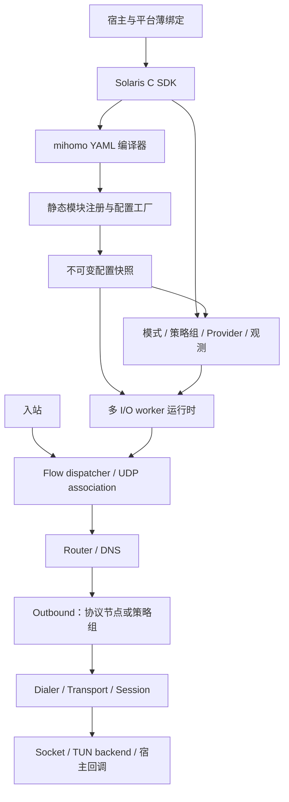

# Solaris Core 架构与模块契约

状态：当前开发规范；实现进度见 [开发计划](DEVELOPMENT_PLAN.md)。

## 1. 项目定位

Solaris Core 是全新开发的可嵌入 C 代理内核库，公开配置兼容 mihomo YAML，宿主集成能力参考 libclash。交付库、头文件、薄平台绑定、测试宿主与可复现构建。

自有运行时、配置编译、路由、DNS 和协议代码使用 C，发布数据面不依赖 Go runtime。已有 BoringSSL 依赖包含 C++；本项目不要求所有第三方依赖重新用纯 C 实现。

现有代码是可复用的实现素材。新目录、SDK、模块契约、配置模型和产物独立定义；不承担原 schema、ABI、结构体布局、函数表和宿主调用方式的兼容义务。HTTP 控制器、Web 面板、独立守护进程不属于当前交付目标。

## 2. Solaris 命名

| 对象 | 约定 |
| --- | --- |
| 自有函数 | `solaris_engine_create`、`solaris_config_compile_yaml` 等 `solaris_*` |
| 自有类型 | `solaris_engine_t`、`solaris_stream_t` 等 `solaris_*_t` |
| 宏、枚举常量和 guard | `SOLARIS_OK`、`SOLARIS_EAGAIN`、`SOLARIS_ENGINE_H` |
| 公开头文件 | `include/solaris/`，例如 `<solaris/engine.h>` |
| 构建标识 | `solaris_core`、`SOLARIS_ENABLE_TUN`；消费目标 `Solaris::core` |
| 原生库 | `libsolaris.so`、`libsolaris.a`、`solaris.dll`、`Solaris.xcframework` |
| 公共组件 | `solaris_tls_*` 等中立名称；协议名只用于对应 adapter/codec |

自有目录、include 路径、符号、配置标识、日志引擎标识、导出表、构建脚本、示例和测试统一清理。新工程不保留 `aproxy` 别名、兼容头文件、deprecated wrapper、旧 schema 转换器或 ABI 桥接。

第三方命名、协议标准名称和来源记录按原有规范保留；历史归档中出现旧名称不代表新接口接受它。

## 3. 分层



配置只在准备阶段使用 YAML/通用节点视图。转发热路径访问编译后的结构体、索引和句柄，不查询 YAML/JSON 树。

依赖规则：

- 公开 SDK 不暴露具体协议配置、libuv、BoringSSL 或 lwIP 类型。
- engine、router、flow relay、宿主 SDK 只依赖通用契约，不 include adapter 私有头文件。
- adapter 使用注入的服务和声明的共享 codec/transport；服务不反向依赖某个 adapter。
- 模块配置编译不创建 socket；实例构造不隐式联网，激活和懒连接由任务作用域管理。
- 网络 socket 的创建、protect、接口绑定与取消由统一服务执行，协议不能绕开平台策略。
- 具体平台 API 归 platform/backend，协议代码不直接调用 JNI、Network Extension、Wintun 或 UI。

## 4. 模块接口

| 契约 | 职责 |
| --- | --- |
| `stream` | 有序字节流、读暂停/恢复、写入、背压、半关闭、关闭屏障 |
| `datagram` | 完整消息与地址、零长度报文、多目的能力、有效长度限制、可选批量发送 |
| `outbound` | 查询有效能力，异步打开 stream/datagram，关闭实例 |
| `inbound` | 管理入口，向 dispatcher 交付连接/报文与 metadata |
| `dialer` | 物理网络或经其他 outbound 拨号，统一 DNS、protect、网络绑定和 deadline |
| `transport` | 提供模块允许的 TCP/TLS/WS/gRPC/XHTTP 等载体 |
| `session` | 管理多个子流共享的连接、keepalive、故障传播和退休 |
| `module descriptor` | 名称/别名、配置编译与释放、实例工厂、依赖与能力声明 |

接口采用 opaque state、C 结构体和 const vtable 组合。规则、DNS upstream、provider 使用各自的窄接口，不加入一个覆盖所有业务的巨型 vtable。

内部接口轮廓如下，类型细节由 M0/M1 的实现任务确定；它不是已发布头文件：

```c
typedef struct solaris_outbound_ops {
    int (*capabilities)(void *state, const solaris_flow_meta_t *flow,
                        solaris_outbound_caps_t *out);
    int (*open_stream)(void *state, solaris_open_request_t *request);
    int (*open_datagram)(void *state, solaris_open_request_t *request);
    void (*begin_close)(void *state);
    void (*destroy)(void *state);
} solaris_outbound_ops_t;

typedef struct solaris_outbound_module {
    const char *type_name;
    int (*compile_config)(const solaris_config_view_t *input,
                          solaris_config_compile_context_t *context,
                          solaris_module_config_t **out);
    void (*free_config)(solaris_module_config_t *config);
    int (*create)(const solaris_module_config_t *config,
                  const solaris_module_services_t *services,
                  solaris_outbound_t **out);
} solaris_outbound_module_t;
```

open request 携带只读 metadata、目标、固定的 dial plan、deadline、取消令牌、owner 和一次完成出口。UDP 额外携带 association 上下文，后续目的报文不重新打开整个协议实例。

services 注入 executor、timer、allocator/budget、resolver、dialer、transport factory 与观测设施，不把整个 engine 指针暴露给模块。

## 5. 注册、配置与能力

模块清单是源码、依赖、构建开关与 descriptor 的唯一枚举来源。显式静态注册、显式引用 descriptor，避免静态库裁剪丢失只靠 constructor 自注册的模块。初始化时检查重名、别名冲突和依赖缺失，然后冻结 registry。

配置编译器执行 `lookup → compile_config → resolve dependencies → create`。公共字段由共享 helper 处理，协议模块拥有其私有不可变配置；跨模块引用解析为有代际生命周期的句柄，不在热路径查全局字符串表。

有效能力取实现、实例配置、所选成员和底层服务的交集，至少包含 TCP、UDP、域名目标、多目的数据报、本地映射复用范围、半关闭、批量发送和长度限制。查询无网络副作用，健康状态独立报告。

模块与库一起编译。内部 vtable 不构成动态插件 ABI；普通新增协议不增加宿主 API 函数或协议 enum，也不引入历史版本协商。

## 6. 需要保持的边界

- 策略组实现 outbound 数据面接口，另提供 group control 接口。选中节点、握手状态与健康状态分别表达。
- UDP 封装归 outbound：UoT/XUDP 使用共享 codec，TUN/SOCKS5 只依赖 datagram/association。
- TLS、WS、gRPC、XHTTP 可复用，组合必须由能力与配置声明允许；QUIC 使用适合 UDP/session 的后端，不强制经过 TCP 流水线。
- Vision 等特殊 raw 切换通过窄能力接口表达，并明确顺序；禁止强转其他模块的 `native()` 私有对象。
- 统计、测速、连接关闭和追踪通过通用包装层适用于所有 adapter，业务字节与传输字节在各自边界只计一次。
- 自动重试不得重放已交付给业务或不可重放的应用数据。

### 协议家族与组合

Shadowsocks 和 VLESS 分别在 `src/adapters/outbound/shadowsocks/`、`src/adapters/outbound/vless/` 内维护 descriptor、配置与协议私有实现。一个协议家族保持一个 registry 入口；加密、flow、UDP 封装属于实例配置和内部组合，不派生新的 outbound 类型，也不在通用层加入协议分支。

| 家族 | 内部职责 | UDP 方案 |
| --- | --- | --- |
| VLESS | 基础请求/响应、VLESS encryption、`xtls-rprx-vision` 分开实现；encryption、flow、底层载体分别校验 | XUDP；由 VLESS 模块建立承载并接入共享 framing，不以 UoT 替代 |
| Shadowsocks | 配置/密钥、AEAD TCP、原生 UDP packet codec 与 socket 生命周期分开 | 原生 UDP 或显式选择 UoT；UoT 经过 SS 的加密 stream |
| AnyTLS | 协议握手/帧与 session 调度分开 | 通过 session 子流接入共享 UoT |

裸 VLESS 指没有 VLESS encryption、没有 Vision flow 的基础协议，可使用已声明的 plain/TLS carrier。VLESS encryption 是协议自身的加密层，Vision 是 flow 行为，两者不能用普通 TLS 的实现代替；允许的组合分别声明和验证。Vision 所需的 raw 切换由中立 transport 的窄能力接口提供，禁止访问 TLS 后端私有结构。协议依据见 [Project X 的 encryption/flow 定义](https://xtls.github.io/config/outbounds/vless.html)。

UoT/XUDP 的线格式 codec 与有界流式 datagram 生命周期放在共享层；adapter 负责选择封装、协议请求和承载。UoT 不能放入 AnyTLS 私有目录后供 Shadowsocks 反向引用。SS 的原生 UDP 与 UoT 共用 datagram 契约，但分别拥有对应封装、背压和错误路径；失败不静默切换方案。参考 [VLESS XUDP 配置](https://sing-box.sagernet.org/configuration/outbound/vless/)、[SS UoT 配置](https://sing-box.sagernet.org/configuration/outbound/shadowsocks/) 与 [UoT 线格式](https://sing-box.sagernet.org/configuration/shared/udp-over-tcp/)。

这些是目标边界；未实现组合不发布能力、不接受后忽略配置。实际支持项见 [兼容矩阵](COMPATIBILITY.md)，M1 的逐项验收见 [开发计划](DEVELOPMENT_PLAN.md)。

## 7. 目录与对象生命周期

```text
include/solaris/                    公开 C SDK
src/api/engine/                     engine SDK facade
src/api/common/                     错误与版本 API
src/core/io/                        地址、通道与 outbound 通用操作
src/core/module/                    registry、配置与实例编排
src/contracts/{io,module,runtime,flow}/  按职责归组的内部契约
src/runtime/engine/                 控制线程、generation 与启停屏障
src/runtime/executor/               I/O worker、mailbox、scope 与 deadline
src/runtime/memory/                 buffer 与预算
src/runtime/security/               跨 worker 重放状态
src/runtime/services/               分配、时钟与失败注入服务
src/config/view/                    类型化配置视图与诊断
src/config/outbound/                dialer/proxy 共用配置
src/flow/udp/                       association、mapping、reply endpoint
src/dns/system/                     异步系统 resolver
src/codec/address/                  共享地址线格式
src/adapters/outbound/{block,direct,shadowsocks,vless,anytls}/  协议家族模块
src/transport/socket/               物理 socket、TCP/UDP 与平台策略
src/transport/stream/               carrier 组合与 record filter
src/transport/tls/                  TLS 通道与信任上下文
src/transport/session/              共享 session、子流与空闲复用
src/transport/datagram/             流式 datagram 生命周期与 UoT 组合
src/codec/uot/                      UoT v2 独立报文编解码
modules/                           模块与构建清单
tests/contracts/{runtime,module,io,transport,flow,outbound}/  组件契约
tests/support/{runtime,io,transport,flow,outbound}/           测试支持与独立对端
tests/{sdk,consumer}/               SDK smoke 与安装消费
scripts/verify/                    符号、模块与安装产物检查
cmake/                             构建入口、依赖与包配置
```

目录按可组合的职责组织，同一组件的实现、私有头文件与后端适配就近放置。新增代码先归入所属组件；出现独立职责或可复用组合时再抽子目录，避免持续向层根目录堆放文件，也不按文件扩展名单独建立 `headers/`、`sources/`。公开 SDK 保持一个稳定的 `solaris/` include 命名空间。

组件之间通过契约或明确的共享服务引用，目录调整不改变依赖方向。codec 归 `src/codec/<用途>/`，socket/TLS/session 等通道后端归 `src/transport/<组件>/`，协议私有组合归 `src/adapters/<方向>/<家族>/`。测试与独立对端按对应组件归组，共用测试工具放在相应 support 目录。移动文件时同步模块清单、CMake、include、脚本路径与当前文档链接。

当前 SS 已分为 `module.c`、`crypto.c`、`stream.c`、`packet.c`、`native_udp.c` 和私有头文件；VLESS 已分为 `module.c`、`stream.c` 和私有头文件；AnyTLS 的模块、session codec 与 padding 分离，通用 session 生命周期位于共享 transport 目录。后续 VLESS encryption、Vision、XUDP 接入代码归其家族目录，UoT/XUDP 的可复用 codec/stream backend 归共享层。YAML parser、router、provider、DNS cache/Fake-IP 与 platform/TUN 在对应阶段按同一规则扩展，未交付组件不创建空实现占位。

配置属于 snapshot，模块实例属于 worker/runtime generation，session 属于模块实例，flow/association 持有本次选定的引用。关闭先停止新任务并排空异步完成，引用归零后才 destroy；配置提交不释放仍被旧连接使用的对象。

并行与 I/O 所有权详见 [运行时](RUNTIME.md)，UDP 语义详见 [UDP/NAT](UDP_NAT.md)，宿主边界详见 [配置与 SDK](CONFIGURATION_AND_SDK.md)。

## 8. 框架成立的标准

基础 adapter 就绪后，再增加 SOCKS5 outbound；允许改动协议模块、注册/构建清单、测试和文档，engine/router/TUN/公共 SDK 不增加协议逻辑。新节点应自动参与策略选择、测速、统计、连接关闭和统一生命周期测试。

全新 L3、内核卸载等语义确实超出现有契约时，可评审并扩展窄接口，同时补公共测试；不通过通用模块中的协议特判绕过边界。

参考 mihomo 的 [adapter 契约](https://github.com/Herta-Network/mihomo/blob/9f121787bb563fe655d2789cbf6dbcc7ae19a0c9/constant/adapters.go) 与 [公共 adapter 实现](https://github.com/Herta-Network/mihomo/blob/9f121787bb563fe655d2789cbf6dbcc7ae19a0c9/adapter/outbound/base.go)。调查过程见 [历史归档](../archive/2026-11-03/FRAMEWORK_ARCHITECTURE.md)。
