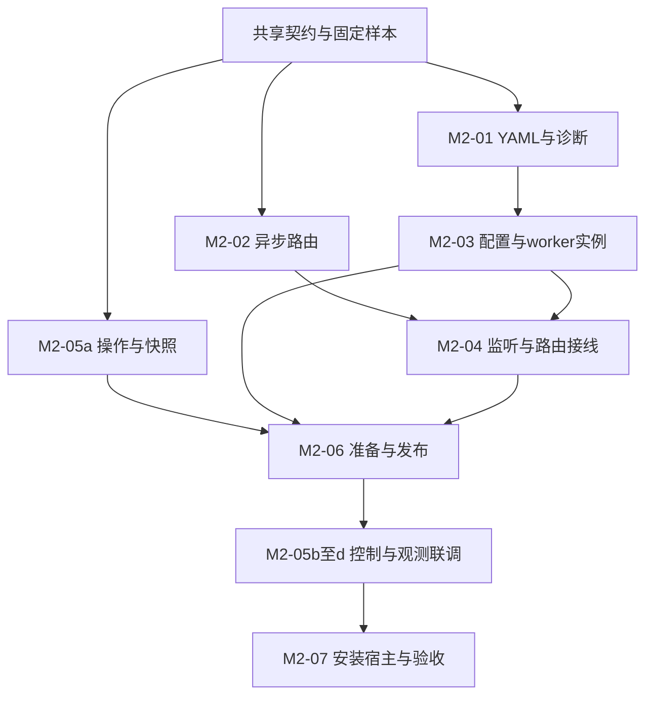

# Solaris Core 开发计划

更新日期：2026-11-06。本文件是实现进度与阶段状态的唯一维护位置。

## 1. 当前状态

| 项目 | 状态 | 说明 |
| --- | --- | --- |
| 目标、框架、SDK、UDP/NAT 与多核设计整理 | 已完成文档基线 | 见 [文档索引](../README.md) |
| 历史文档归档 | 已完成 | 原 README、嵌入说明、四份草案与调查证据 |
| M0 新工程骨架、Solaris 命名与基础 SDK | 已提交并推送 `8fa5180`，CI 通过 | 新 CMake/模块清单、私有 libuv、异步生命周期与安装消费 |
| M1 框架与首批数据面 | M1-01–M1-08 的实现与本机功能验收完成 | M1 基线四种构建各 40 项；后续 TLS 扩展矩阵为 45 项，见下方记录 |
| TLS 库扩展 | 五个补丁已实现，本机验收通过 | 四协议独立握手/交接测试；生产出站和配置接入仍分开推进 |
| 协议补全与 TUN | XUDP 恢复、SS2022 ChaCha/EIH、多用户与 AnyTLS 协商/会话已补齐；TUN 内部数据面提前实现 | lwIP/system、平台设备层及边界见 [TUN 用法](TUN.md)；插件仅预留接口 |
| M2 | 已完成实现与本机功能验收 | 完整配置差分、14 组验收及安装宿主已交付；未归因短包作为已知问题继续跟踪，见 5.11 |
| M4–M6 | 未开始 | Provider、扩展协议、平台与性能继续按阶段推进 |
| 新 SDK/生命周期/安装消费验收 | macOS arm64 通过 | 共享/静态、完整 40 项、独立 C/C++ 消费、ASan/UBSan 与 TSan；详见最终记录 |
| 远端 CI | M0 CI 通过；M1 远端 CI 尚未验收 | 不把 M0 的通过状态延伸到新代码 |
| 代理协议互通、设备与性能验收 | M1 声明组合的常规互通通过；设备/性能未验收 | 长重复 Xray UDP 存在独立控制端也可复现的外部限制，不宣称生产稳定性 |

本计划不承诺未经测量的工期和吞吐。各阶段按依赖与验收推进；普通开发不要求保留原接口兼容。

## 2. 阶段依赖与交付目标


| 阶段 | 可交付结果 | 退出门槛 | 当前状态 |
| --- | --- | --- | --- |
| M0 | 正常构建、安装、调用的新 Solaris 最小库 | G-BUILD、基础 G-LIFE | 已完成本机与 CI 验收 |
| M1 | 模块注册、统一 I/O、UDP association、至少两个 workers；新增协议不改通用层 | G-MODULE、G-LIFE、G-WORKER、基础 G-UDP/G-INTEROP | 实现与本机功能验收完成；远端 CI 未运行，长重复限制见下文 |
| M2 | 宿主可加载基础 mihomo YAML、代理、切组、查询与关闭连接 | G-CONFIG、G-RELOAD、已声明协议 G-INTEROP | 已完成实现与本机功能验收；完整差分、逐项证据和已知问题见 5.11 |
| M3 | DNS/Fake-IP、双栈 TUN 与 Android/Apple VPN 闭环 | 完整基础 G-UDP、相关 G-DEVICE | TUN 内部数据面已实现；DNS/Fake-IP/sniff/公开绑定和真机闭环未完成 |
| M4 | Provider、完整常用策略组、Geo/rule-set 与日常配置样本覆盖 | 扩展 G-CONFIG/G-RELOAD/G-INTEROP | 未开始 |
| M5 | 更多协议/传输与 Windows/Linux/OpenHarmony 集成 | 新增组合 G-INTEROP、各平台 G-BUILD/G-DEVICE | 未开始 |
| M6 | QUIC 等高级能力、栈扩展和有测量依据的性能策略 | 对应 G-INTEROP/G-DEVICE/G-PERF | 未开始 |

门槛定义见 [测试规范](TESTING.md)。M2 是首个宿主业务可用的基础库目标；M4 是日常配置覆盖目标。任何阶段都不能自动推导成全量 mihomo 功能兼容。

## 3. M0：新工程与 SDK 骨架

| 任务 | 交付物与范围 | 验收 | 状态 |
| --- | --- | --- | --- |
| M0-01 | 确定主构建入口、单一模块清单格式、YAML/JSON 库与依赖固定方式；记录取舍 | 选型可覆盖目标平台，模块源码/依赖不维护重复清单 | 已完成：CMake、JSON 清单、依赖 lock；解析器尚未链接 |
| M0-02 | 建立 Solaris 目录与最小构建目标；自有命名、头文件、导出、示例统一 | 新构建不编入原框架；无旧前缀别名/桥接；来源声明保留 | 已完成，新源码/导出无旧命名 |
| M0-03 | 定义 engine/host/options/error/snapshot 的最小 C SDK，所有权与线程约定 | create/stop/destroy、错误和回调屏障 smoke 通过 | 本机通过 |
| M0-04 | 库安装与独立消费样例、产物命名、依赖链接和导出检查 | 消费者只用安装目录即可编译链接运行 | 本机共享/静态及搬迁消费通过 |
| M0-05 | 建立测试入口、CI 基础与可注入时钟/失败工具 | 在本机和首个 CI 平台执行 G-BUILD/基础 G-LIFE | M0 本机与 CI 均通过 |
| M0-06 | 固定参考提交、依赖与构建开关；建立配置/协议兼容矩阵初版 | 每条支持状态能关联到计划任务或测试；未验证项明确 | 已完成初版 |
| M0-07 | 确定首个 TUN backend 的状态隔离、packet 接口与栈 owner 边界 | 原 lwIP 若复用则明确串行约束；多 worker 不直接访问全局栈 | 已完成边界设计，backend 代码待 M1/M3 |

原 SDK 的缺失链接问题可作为经验，不要求先修好旧构建才开始新工程。原可复用代码进入新目录时接受新命名与契约，不设置长期平行的 legacy 实现层。

工程决策见 [M0 决策记录](M0_DECISIONS.md)，当前 API 见 [SDK](SDK.md)，支持范围见 [兼容矩阵](COMPATIBILITY.md)。

### 本次本机验证记录

环境：macOS arm64、AppleClang 21.0.0、CMake 4.4.5、Ninja；libuv 1.53.0 固定归档。历史文档基线为 `532c13a`，本节验证记录随 M0 实现提交保存，对应该提交的源码。

| 构建目录 | 检查 | 结果 |
| --- | --- | --- |
| `build-m0-shared` | Debug 共享库、SDK smoke、8 组生命周期契约、9 个导出、搬迁后的 C/C++ 消费、最小宿主 | 通过 |
| `build-m0-static` | Debug 静态库、SDK smoke、相同生命周期契约、搬迁后的 C/C++ 消费 | 通过 |
| `build-m0-asan` | ASan/UBSan、SDK/生命周期、导出与安装消费 | 通过；消费测试已使用配对 C/C++ 工具链复测 |
| `build-m0-tsan` | TSan 下的 SDK smoke 与生命周期契约 | 通过 |

标准复现步骤见 SDK 文档。Sanitizer 构建使用 `-DSOLARIS_SANITIZER=address|thread`，并通过 `FETCHCONTENT_SOURCE_DIR_SOLARIS_UV` 复用共享构建已校验的依赖源码。日志位于对应构建目录的 `Testing/Temporary/LastTest.log`；配置/编译日志位于 `build-m0-bootstrap/`。

本节是提交前的本机证据，远端 CI 结果在实际运行后单独记录。尚无其他 OS 本机验证、协议互通、系统 VPN 或性能测量结果。M0 支持一个控制 worker，不计为 M1 的多 worker 验收。

## 4. M1：证明框架成立

| 任务 | 交付物与范围 | 验收 | 状态 |
| --- | --- | --- | --- |
| M1-01 | 多 worker executor、mailbox、timer、取消、generation、scope 与关闭屏障 | 至少两 workers；无丢唤醒/重复完成；关闭中释放与通知可完成 | 本机通过：多 worker/scope/deadline/barrier |
| M1-02 | stream/datagram、owned buffer、背压、半关闭、accepted batch 契约 | 公共 I/O 契约测试与内存检查 | 本机通过：stream/datagram/buffer 与背压 |
| M1-03 | registry、module descriptor、配置视图/helper、factory 和静态裁剪 | 新类型可注册/构造/禁用；重复名与依赖错误准确 | 本机通过：冻结 registry、配置/实例所有权、失败回收与三种裁剪组合 |
| M1-04 | 统一 dialer/socket 服务、最小 resolver、protect 与网络绑定；Direct/Block | TCP/UDP 本地对端；失败/取消时 socket 生命周期正确 | 本机通过：Direct/Block、系统解析、同步 socket 策略与本地 bind |
| M1-05 | UDP association、目的映射、reply endpoint、worker 归属与 deadline | U01–U04、U08 及 U09/U10/U12 的数据报子集 | 本机通过：关联隔离/合并、固定 owner/plan、双栈/域名、真实源端口、deadline/关闭与失败回收 |
| M1-06 | 中立 TLS/transport/session；VLESS 基础协议、encryption、Vision、XUDP；SS 原生 UDP/UoT；AnyTLS/session/UoT | 下表逐项验收，覆盖普通流、协议加密/raw 切换、原生/流式 UDP 与共享 session | 已接入全部子项，常规互通/边界测试通过；长重复外部限制单独记录 |
| M1-07 | 最小 select/计划固定、通用单次测速、流量与连接追踪 | 不按协议分支实现；统计不重复，健康/选择状态区分 | 已实现：共享选择、固定 plan、独立健康、观测/关闭、物理计数和 HTTP(S) probe；本机验证通过 |
| M1-08 | 增加 SOCKS5 outbound 作为扩展试验 | 仅模块、注册/构建清单、测试/文档变化；TCP/UDP、选择、测速、关闭通过 | 本机通过：CONNECT/UDP ASSOCIATE、认证、控制连接、失败回收及独立裁剪 |

M1 的模块配置可以由测试视图构造，完整 YAML/策略控制在 M2。接口必须经不同协议模型验证，不能只以 Direct 或纯 TCP 协议认定框架完成。

### M1-06 协议范围与退出条件

协议按家族分目录，边界见 [架构规范](ARCHITECTURE.md#协议家族与组合)。以下子项全部属于 M1-06，不能把裸 VLESS/TLS 的通过记录当成 VLESS 家族已完成，也不能仅凭 AnyTLS UoT 覆盖 SS UoT。

| 子项 | 必须交付与验收 | 当前状态 |
| --- | --- | --- |
| M1-06a 共用 transport | carrier/TLS/record filter；session 与 raw 切换窄接口的所有权、背压、故障和退休验证 | carrier/TLS/filter/session 与方向独立的 raw 切换已实现并验证 |
| M1-06b 裸 VLESS | 无 encryption/flow 的基础协议，plain/TLS carrier 的双 worker、双栈、域名、错误认证与关闭 | 已实现并通过本机独立对端 |
| M1-06c VLESS encryption | 独立加密层与配置校验；固定 Xray 对端的握手、认证、记录边界、篡改/重放、超时/取消；启用的会话恢复模式逐项验证 | 已实现三种 appearance、1-RTT/0-RTT、双类认证密钥及 relay；固定 Xray 互通、独立 crypto fixture 和生命周期本机通过 |
| M1-06d Vision | `xtls-rprx-vision` 的 flow、padding、内层 TLS 识别、raw 切换及缓冲交接；TLS 与 encryption 承载组合分别验证，明确 UDP 443 语义 | 已实现；真实内层 TLS 的双向 raw、padding/识别、TLS/encryption 组合和 UDP 443 策略本机通过 |
| M1-06e VLESS XUDP | VLESS 的 datagram 路径采用 XUDP；双栈/域名、多目的、真实回复地址、空包、拆粘包/截断、session 故障及 association 关闭 | Single XUDP 与跨连接 GlobalID 恢复已实现，固定 Xray 验证映射连续且无数据报重放；plain/TLS/encryption/Vision、异常帧及取消通过 |
| M1-06f SS TCP/native UDP | 六种 cipher 与 AES EIH/多用户链的 TCP、原生 UDP、重放状态及生命周期 | 已实现并通过本机独立对端与异常报文测试 |
| M1-06g 共享 UoT | UoT v2 codec/流式 datagram backend；分别接入 SS 加密 stream 与 AnyTLS 子流；每个支持的 SS cipher 运行 UoT 互通与取消/背压/关闭测试 | 共享 backend/codec 的 SS/AnyTLS 接入已实现并通过本机互通；三种代理封装的 association 组合已验证 |
| M1-06h AnyTLS/session | TLS、认证、padding、session 复用与故障传播；通过共享 UoT 提供 datagram | AnyTLS v1/v2、padding、空闲配置与 TCP/UoT 已实现，互通和 session/codec 边界通过 |

每个组合必须通过配置→registry→工厂入口，并声明有效能力；不支持的 encryption/flow/UDP 方案明确拒绝，不能静默降级。协议加密、flow、carrier 和 UDP 封装分别登记，不宣称任意组合可用。XUDP/UoT 的 U06 内部数据路径在 M1 验收，YAML/入站接入在 M2 验收。逐项测试要求见 [测试规范](TESTING.md#6-协议与解析器)。

M1 功能范围已实现；未实现功能没有新增配置入口或占位成功路径。TLS 扩展的版本、补丁及协议边界见 [TLS 后端](TLS_BACKEND.md)。


### M1 首批验证记录（2026-11-04）

实现边界与内部接口见 [M1 数据路径](M1_DATA_PATH.md)。首批对应 M1-01/M1-02/M1-04，不代表整个 M1 完成。

- `sdk_smoke` 与原有 8 组生命周期契约继续通过。
- `executor_contract`：5 组 worker/scope/deadline/buffer 契约，包括 192 个 scope 的分批排空。
- `io_contract`：独立 Python 对端验证 6 个 TCP 场景、3 个 UDP 场景，以及拒绝、deadline、活动通道停止。覆盖 IPv4/IPv6、localhost、半关闭、背压、空包、备用源端口与同通道多目标复用。
- macOS arm64 的共享/静态安装消费、ASan/UBSan、TSan 验证通过。当前代码尚未提交/推送，不宣称 M1 的远端 CI 已通过。

构建目录沿用 `build-m0-shared`、`build-m0-static`、`build-m0-asan`、`build-m0-tsan`；这些目录现在对应 M1 工作区，不再是 M0 的冻结产物。M0 的固定证据是提交 `8fa5180` 和 [CI run 41763575334](https://github.com/Anti-EntropyTech/Solaris-Core/actions/runs/41763575334)。M1 日志在各目录的 `Testing/Temporary/LastTest.log`，编译日志在 `build-m0-bootstrap/m1-*.log`。

### M1-03 验证记录（2026-11-05）

- `module_contract` 通过：新增测试 descriptor 的注册/构造，重复规范名/别名、缺失依赖、依赖环、未知/禁用类型、配置类型/范围/字段诊断；配置在输入修改及 registry 销毁后有效，双 worker 使用同一不可变配置，异步实例资源随 retire/stop 排空。
- 注入 registry、配置 wrapper/payload、实例 wrapper/state 的分配失败，以及模块编译/工厂部分成功后失败；返回空输出，已分配状态清理，预算归零，无拒绝后的 on_close。
- Direct/Block 的 `io_contract` 改为经 registry→配置→工厂打开 TCP/UDP；编译的队列限制/deadline、注入 socket policy、本地 bind 与实例先退休/通道继续工作均通过。
- macOS arm64 共享构建全套测试、静态构建全套测试及安装 C/C++ 消费通过；ASan/UBSan 与 TSan 的 `module_contract`、`io_contract` 通过，新增分配失败用例另行复测通过。
- `build-m1-direct-only`、`build-m1-block-only`、`build-m1-no-outbounds` 三种静态裁剪构建各通过全部 7 项测试；registry 内容、archive/最终可执行文件的 descriptor 符号和安装消费均符合开关。
- 复现：正常构建使用 README 命令；裁剪增加 `-DBUILD_SHARED_LIBS=OFF -DSOLARIS_ENABLE_DIRECT=ON|OFF -DSOLARIS_ENABLE_BLOCK=ON|OFF`。ASan/TSan 使用既有 sanitizer 开关。CI 已加入裁剪矩阵，但本次未提交/推送，未运行远端 CI。

M1-03 通过不等于 G-MODULE 完整通过；新增 SOCKS5 的扩展试验仍属于 M1-08。

### M1-05 验证记录（2026-11-05）

- `udp_association_contract`：独立 Python 对端核对 A/B/A 本地端口复用；相同源地址在不同 engine/入站隔离；8 个并发提交合并为一个关联并按上限接纳 3 个；worker 集合由 2 改为 1 时存量不迁移、新关联使用新集合。
- 同一关联经过数值 IPv4、localhost 解析和 IPv6 空报文；备用源端口原样回复；映射/队列/消息长度限制、batch 前缀、拒绝计数、端点引用、固定 plan、预算归零通过。备用 IP 的元数据传递由受控通道补测，不声称 macOS loopback 上已运行备用 IP 网络对端。
- `udp_lifecycle_contract`：open 超时及成功回调先于 timer 处理的迟到成功、DNS 迟到/停止后完成、scope 建立前的排队首包停止、idle 不被队列满或回复拒绝延长、单目的子通道、旧 ID/回复 generation、选路拒绝、scope 上限、关联/请求/映射分配失败。拒绝无回调，接受恰好一次完成，stop 等待实际回调排空。
- 共享/静态构建各 10 项测试、C/C++ 安装消费通过；ASan/UBSan 与 TSan 的模块和 UDP 两组契约通过。三种裁剪配置重新验证：仅 Direct 9 项、仅 Block 8 项、全部关闭 8 项均通过；association 公共层不依赖某个 adapter。
- 测试脚本、断言与日志是本机工作区证据；未提交/推送，未执行远端 CI、代理协议互通、TUN/设备或性能验收。

### M1-06 当前验证（2026-11-05，阶段仍未完成）

- 中立 TLS 使用固定 BoringSSL、私有符号、有限 BIO pair 和明文队列；OpenSSL 对端通过证书身份/信任拒绝、超时、取消、暂停、背压、截断与关闭。TLS 自有代码的 ASan/UBSan、TSan 通过；BoringSSL 内部堆不计入 Solaris buffer budget。
- VLESS TCP 和普通 TLS 经 registry/factory 接入；固定 sing-box v1.12.12 独立对端验证双 worker、IPv4/IPv6/domain、内容完整性、半关闭、错误凭据与取消。受控对端补充拆分 header/addons、错误版本、截断 header 与无响应 EOF；ASan/UBSan、TSan 的同组互通测试通过。仅支持十六进制 UUID、无 flow/附加安全层；不声明 VLESS UDP、Vision/REALITY 等组合。
- 共享/静态各 13 项本机检查通过，包括私有 TLS/crypto 符号隔离及搬迁消费。静态纯 C 宿主强制链接整个 core archive，验证可选模块依赖；安装不暴露 BoringSSL/libuv 头文件。新增协议尚未提交/推送或运行远端 CI。
- SS 支持 aes-128-gcm、aes-256-gcm、chacha20-ietf-poly1305、2022-blake3-aes-128-gcm 和 2022-blake3-aes-256-gcm，TCP/native UDP 均经 registry/factory 和双 worker 独立对端验证。UDP 覆盖同族 A/B/A、IPv6 lane、域名首包、空包、6 KiB 实际回包、背压、错误凭据及取消；65,000 字节协议 payload 边界用独立 Go 加密 fixture 验证，未宣称本机网络可发送该尺寸。
- 独立 fixture 验证 TCP tag/长度/截断/响应请求 salt/时间边界，UDP tag/type/time/client session/address、重复/过旧 packet ID、两组 server session 保留与容量/分配失败；共享 exact replay store 验证并发唯一接纳和满表拒绝。ASan/UBSan 与 TSan 的 SS 和 VLESS 互通/codec 测试通过。
- sing-box v1.12.12 在本机同一 UDP 映射先数值 IPv4 后 IPv6 或域名不回包；独立 sing-shadowsocks v0.2.8 客户端对同一 peer 复现，独立 IPv6 映射及域名首包成功。该限制不通过改写客户端目标或首包 source 隐藏。
- SS 新增后共享构建完整 15 项通过；静态运行时/符号 14 项通过，安装消费发现 Threads 导出依赖遗漏，修复后单独重验通过。新增独立 BLAKE3 符号审计通过；仅 SS 出站的静态裁剪构建完整 13 项通过。新增协议未提交/推送或运行远端 CI。
- VLESS encryption/Vision/XUDP、UoT 的 AnyTLS/association 接入、AnyTLS/session 与 M1-07/M1-08 尚未完成；以上记录不代表 M1 退出门槛通过。

目录重构后（2026-11-05），macOS arm64 共享构建全套 16 项、静态构建相关 9 项通过，包含 VLESS/SS 互通、SS codec、模块/密码符号与安装消费。源码对照确认 SS 仅改变路径/include，VLESS 仅拆分模块与基础 codec；本次未新增协议能力或重跑 sanitizer。日志为 `build-m0-bootstrap/m1-layout-{shared,static}-{configure,build,test}.log`。

组件归组后（2026-11-05），API、core/contracts、runtime、config、transport、DNS/codec、Direct/Block、测试与验证脚本按职责分目录。源码/构建内容对照确认只调整路径与安装验证脚本的仓库根定位；共享/静态全套各 16 项、全部出站关闭 8 项、仅 SS 13 项通过。日志为 `build-m0-bootstrap/m1-components-*.log`。

共享 UoT/SS 接入后（2026-11-05）：共享与静态构建全套各 18 项通过；ASan/UBSan、TSan 的 UoT codec、流式 datagram lifecycle、SS codec 与 SS native/UoT 互通通过。错误凭据用例补充了 stream 在写入完成前被对端拒绝的合法失败结果，sanitizer 互通复测通过；没有 sanitizer 报告。日志为 `build-m0-bootstrap/m1-uot-*.log`。AnyTLS、XUDP 及代理 association 的组合验收仍待完成。

AnyTLS/session 接入后（2026-11-05）：共享与静态完整构建各 21 项通过；全出站/TLS 关闭的静态裁剪 11 项通过。新增 session 契约验证多子流、最新空闲 session、deadline、分配失败、部分帧取消及 stop 等待；AnyTLS codec/固定独立对端验证 v2、padding 更新、TCP/UoT、复用和畸形响应。最终 diagnostic sink/队列默认值补充后，ASan/UBSan 与 TSan 的这三组测试重新通过，静态同三组及安装消费重新通过；无 sanitizer 报告。日志为 `build-m0-bootstrap/m1-anytls-*.log` 与 `m1-session-*.log`。尚未完成 VLESS encryption/Vision/XUDP、代理 association 组合或 M1-07/M1-08；没有远端 CI/设备/性能结论。

### XUDP 与 U06 代理 association 验证（2026-11-05）

- VLESS CommandMux 3 与独立 XUDP codec 已接入共享流式 datagram backend，未在通用 association 中增加协议分支。Single XUDP 的每个 datagram channel 拥有一条承载流，session ID 为 0；本阶段没有跨连接重连/global-ID 恢复。
- `xudp_codec_contract` 与 `xudp_stream_contract`：独立 Python fixture 覆盖 IPv4/IPv6/domain、空包、65,535 字节 payload、255 字节域名、拆粘包、metadata 长度/类型/ID、KeepAlive、End 的最后一包、错误标记、分配失败回滚、deadline、背压、取消后迟到 write 和 stop 屏障。
- `xudp_interop_contract`：固定 sing-box v1.12.12 与 Xray v26.10.31（`a4a3dff5b20c2faae567b742c172c7b95e75c083`）的 plain/TLS 双 worker、同族 A/B/A、IPv6、域名首包、备用回复端口和错误凭据/取消通过。Xray 另通过同一通道跨 IPv4/IPv6/domain。测试 Xray 只显式允许临时回环 UDP 目标，不改宿主网络设置。
- 两个固定外部对端均不返回空 XUDP；sing-box 还在同一通道从 IPv4 转 IPv6 时结束该 session。独立 sing-vmess v0.2.7 客户端在同一 peer 先验证正常回包再复现限制；支持空包的独立 Python VLESS/XUDP/TLS 对端通过真实 UDP echo 验证 Solaris 的完整空包与多目标路径。
- 共用 `tests/contracts/flow/udp/proxy.c` 经配置→registry→工厂验证 SS 五种 cipher 的 native UDP/UoT、AnyTLS UoT、VLESS XUDP。覆盖两个固定 owner、worker 集合更换后不迁移、一个 plan/三个 family lanes、A/B/A、域名、空包、批量接纳前缀、快照、配置提前释放、显式 association 取消及 executor stop 排空。XUDP 还覆盖异常/截断/End 对 association 的故障传播与已接纳回调排空。
- 本机共享/静态构建各完整 24 项检查及安装消费通过；XUDP/流式 datagram/VLESS TCP 的 ASan/UBSan、TSan 通过，三组代理互通与 association 的 sanitizer 检查也通过。测试以 owner fence 等待回调返回后读取快照；该版本已重跑静态及两种 sanitizer 的三组代理互通。全出站/TLS 关闭的静态裁剪构建 13 项通过。
- 一次 Xray 首包请求在正常对照成功后超时，尚未归因；随后同组 12 轮连续通过。此时未归因；后续复核见下方最终验收记录，不把单纯重跑通过当成原因证明。未运行远端 CI、设备或性能验收。

### VLESS encryption 验证（2026-11-05）

- 支持参数、资源上限和恢复语义见 [M1 数据路径](M1_DATA_PATH.md#vless-encryption)。VLESS 的配置→registry→工厂接入独立 encryption filter；TLS 与 encryption 可组合，UDP 仍走共享 XUDP/association。
- 固定 Xray v26.10.31 的 native/xorpub/random、X25519/ML-KEM/混合 relay、1-RTT/0-RTT、多轮连接、TLS、双 worker/双栈/domain、错误 UUID/服务端密钥、取消及 XUDP/association 通过。独立 Go fixture 确认真实恢复握手、恢复请求重放拒绝、两种 AEAD、握手/记录认证与 nonce 回绕换钥；另验证缓存过期、同代失败清理、旧代失败隔离、分片/截断与分配失败回滚。
- `stream_filter_contract` 验证握手 ready gate、响应先于最后一次 preface write 完成、padding 延时、读暂停、绝对 deadline、取消及 stop 等待迟到回调。共享构建 27 项分组验证、静态完整 27 项和安装消费通过。ASan/UBSan、TSan 的新增三组测试通过；最后补充未确认恢复关闭清理后，静态全套及共享 codec 重新通过。
- 默认 Xray 构建改用同一提交对应的 Go pseudo-version，独立执行默认 `go install` 路径并核对版本/完整提交成功。日志为 `build-m0-bootstrap/m1-encryption-*.log`。未提交/推送或运行远端 CI；Vision/raw 切换、M1-07/M1-08 仍未完成。

### Vision/raw 与 M1-07 验证（2026-11-05）

- Vision/raw 后共享与静态完整 30 项通过；raw/filter、Vision codec/互通、encryption codec、SS codec 的 ASan/UBSan 与 TSan 通过。负向配置测试复现并修复 VLESS/SS 对空 compile payload 的清理崩溃，未知/缺失字段回归通过。
- `select_contract` 验证跨 worker 共享选择、固定 leaf/修订、旧 plan/组退休和健康 token；`observation_contract` 验证准确计数、活跃/历史上限、并发查询、跨线程关闭、队列满、迟到完成、取消与资源失败；`probe_contract` 验证 URL/header、完整响应与写完成、绝对 deadline、取消与失败回收。各现有代理 TCP/UDP/association 套件均经过观测层，`proxy_probe_contract` 经独立 HTTP(S) 对端覆盖所有现有出站。
- M1-07 的 ASan/UBSan 9 组通过；TSan 的一次测试发布时序错误已修正（stop 可以在第二次 write 前关闭 admission），相关 observation/probe 重新通过，其余 8 组通过。全出站/TLS 关闭的静态裁剪 17 项通过。日志为 `build-m0-bootstrap/m1-observe-*.log`。
- `SOLARIS_BUILD_FUZZERS` 使用独立插桩 core；244 份协议/独立密码样本启动的 61 秒运行完成 1,077,892 次输入，覆盖边由 3,592 增至 4,014，无 ASan/UBSan 或预算断言错误。日志为 `build-m0-bootstrap/m1-fuzz-run.log`，并已加入 CI fuzz job；远端 CI 尚未运行。
- 仅 VLESS 裁剪首次运行中出现一次 encryption association 超时，未归因。随后 80 次带跟踪 association、80 组完整前置后的 UDP/association、400 组无跟踪 UDP/association，以及独立 Go 客户端四种承载各 100 轮双 worker 对照均通过。这属于当时的复查记录；最终验收补充了端口碰撞复现和独立控制端异常证据，见下文。

### M1 最终本机验收（2026-11-05）

M1-01–M1-08 已实现，G-BUILD/G-MODULE/G-LIFE/G-WORKER 及本阶段 G-UDP/G-INTEROP 的功能范围通过本机验收。
这是内部框架和声明组合的功能验收；不包含 M2 公开业务入口、远端 CI、真机或长时间生产稳定性结论。

- BoringSSL 固定为 0.20261020.0，锁定 tag/commit/归档与源码树哈希；干净复制、顺序补丁及结果树校验接入 CMake。
  Hello 认证/X25519 基础补丁已实现，真实 TLS transcript、PSK binder/恢复、错误身份、HRR/时序拒绝和补丁完整性检查通过。
  此处为当时首个补丁的记录；后续完整 TLS 补丁实现见下一节。四协议的生产出站接入仍与底层能力分开验收。
- SOCKS5 经 registry/factory 接入，无认证/用户名密码、TCP/UDP、双 worker、IPv4/IPv6/domain、wildcard/domain relay、
  备用源端口、异常报文丢弃、控制连接故障、整体 deadline、DNS 取消、真实 close 屏障与分配失败检查通过。
  select/固定 plan、测速、观测和 association 复用原有入口，未向通用层添加 SOCKS5 特判。
- 最终检查额外复现了通用 executor 停止顺序缺陷：关闭 admission 后，排队 TLS pump 在 scope 取消前运行，错误返回 ECLOSED。
  现先按原有有界批次发布 scope 取消，再推进 deferred 工作。确定性复现改为 ECANCELLED，192 scope 排空和全部生命周期检查继续通过。
  这是通用停止语义修复，与协议扩展没有耦合。

| 本机配置 | 结果 | 日志 |
| --- | --- | --- |
| Debug 共享 | 全部 40 项通过，含所有协议组合、私有符号、导出与安装消费 | `build-m0-bootstrap/m1-final2-shared-test.log` |
| Debug 静态 | 全部 40 项通过，含搬迁后的纯 C/C++ 消费 | `build-m0-bootstrap/m1-final2-static-test.log` |
| ASan/UBSan | 全部 40 项通过；BoringSSL ssl 层也插桩，crypto/libuv 内部未插桩 | `build-m0-bootstrap/m1-final2-asan-test.log` |
| TSan | 全部 40 项通过，无 race 忽略；同样包含 ssl 层插桩 | `build-m0-bootstrap/m1-final2-tsan-test.log` |
| 仅 Direct / 仅 Block / 全关闭 | 分别 18 / 17 / 17 项通过 | `build-m0-bootstrap/m1-final3-*-only-test.log`、`m1-final3-no-outbounds-test.log` |
| 仅 SOCKS5、关闭 TLS/crypto | 全部 21 项通过 | `build-m0-bootstrap/m1-final3-socks5-only-test.log` |
| 仅 TLS、从锁定 URL 全新下载 | 全部 22 项通过；宿主 Clang 23.1.4，主矩阵使用 AppleClang 21 | `build-m0-bootstrap/m1-final3-tls-only-test.log` |
| Parser fuzz | 19 个入口、270 份独立种子，61 秒 781,968 次输入，峰值 RSS 504 MiB；无 sanitizer/预算错误 | `build-m0-bootstrap/m1-final-fuzz-run.log` |

fuzz RSS 是 fuzz 进程的观测值，不是内核生产内存或吞吐结论。

重复互通的证据与限制：

- 复现了 macOS 双栈 UDP 临时端口与 IPv4 回显端口重合，回复被送回回显服务自身。独立 socket 程序在 389 次绑定时复现；
  测试目标改为同时预留两种地址族，同端口自回环立即报错。64 个预留端口的 10,000 次双栈临时绑定无重合。
  固定 sing-box/Xray 的 plain XUDP 扩展重复 250 轮通过，含 Xray 混合地址族及双 worker。
- Shadowsocks 的全局“唯一源端口数”断言把不同已关闭测试的端口复用误判为失败，现按同一次测试的两条活动通道验证 A/B/A，
  不再要求 OS 永不重新分配旧端口；内容完整性和同连接复用检查保留。
- 守护测试端口后，长重复 Xray encryption/XUDP 仍出现偶发无回复。**仅独立 Go 客户端运行时也复现了相同批量或额外 lane 超时**。
  Solaris 诊断显示缺失回复的 TCP 保持读取、各层输入为空且无待写/暂停数据；目标端收到并发送了对应数据报。
  这不是已定位并修复的 Solaris codec 缺陷，尚不能进一步断定是 Xray、内核还是本机网络环境的具体原因。
  常规互通已通过，长重复稳定性保留为外部对端/环境限制；库没有增加重试、伪造回复或改写目的地址掩盖。
  证据为 `m1-xudp-port-collision.txt`、`m1-encryption-peer-boundary.txt` 及其中引用的原始日志。

以上记录是提交前的本机验证；不包含 M1 远端 CI、系统 VPN、其他 OS 本机或性能测量证据。构建产物清理后，表中的本机日志、下载的参考源码和临时诊断文件不随源码保留；验证入口保留在 tests/ 和 scripts/ 中，可按测试规范重新运行。

### TLS 库扩展验收（2026-11-06）

已实现 [TLS 后端文档](TLS_BACKEND.md) 中的全部库级补丁，基线保持 BoringSSL 0.20261020.0，patch ABI 升为 5。
补丁按顺序和 SHA-256 校验，未建立长期 fork 分支；协议密码运算和线格式位于测试消费者，未新增占位出站或配置字段。

- 新增记录 AEAD 事务试探/回滚、精确 Finished 密文捕获、JLS ServerHello 认证与受限签名替代、PSK 绑定的身份/SNI/generation 恢复标记。
- TLS 1.2 提前生成并复用 X25519/P-256/P-384；TLS 1.3 hybrid 认证可直接使用实际 share 中的 X25519 部分，不导出私钥。
- 新增单连接禁用恢复策略，真正停止 TLS 1.3 PSK/modes 广告；`SSL_OP_NO_TICKET` 单独不能完成此要求。
- 固定 Go 参考端运行 53 个独立场景：REALITY mixed/hybrid-only、ShadowTLS v3、Restls TLS 1.2 三组曲线与 TLS 1.3 的完整/恢复、JLS 完整/恢复及元数据隔离。
  正向场景实际完成双向数据。负向包括错误密码/身份/short ID/时间、未认证回退、签名算法与空签名、篡改 session 标记等。
  服务端用真实流量密钥重新封装的错误 Finished 仍被拒绝，证明替代证书认证没有绕过 Finished 验证。
- 七组 TLS 补丁/recipe 契约通过，包含碎片 BIO、输入/输出生命周期、CBC 拒绝、DTLS/QUIC/ECH 和不兼容设置在发送前拒绝。
- macOS arm64、Clang 23.1.4：共享、静态、ASan/UBSan、TSan 全部各 45 项通过，包含普通 TLS、Vision raw、现有协议、私有符号与搬迁后的独立 C/C++ 消费。
  TLS-only 静态构建 27 项、完全关闭出站/TLS 的静态构建 17 项通过。日志位于 `build-tls-bootstrap/` 的相应 `*-test.log`。
- fuzz 增加 TLS session 解析/序列化入口，使用独立握手产生的合成票据和变异标记。20 个入口、280 个种子、61 秒 124,770 次输入，无 ASan/UBSan/预算断言错误；峰值 RSS 521 MiB。
  本次专用 fuzz 构建也插桩 BoringSSL C++，结果是解析器验证，不是生产吞吐或内存承诺。

以上是本次提交前的本机验证记录，不包含远端 CI 或其他 OS 本机验证。M1 已记录的 Xray UDP 长重复对端/环境限制保持独立，不由 TLS 补丁通过记录推导为已修复。

## 5. M2：基础配置和宿主业务闭环

计划基线：`6a16f60`，2026-11-06。下列任务定义全阶段范围与验收条件；分批实现记录见 5.8–5.10，M2 已完成实现与本机功能验收，最终状态和已知问题见 [5.11](#511-完整配置差分与-m2-07-验收矩阵)。
M2 的交付目标是：**仅使用安装后的 C SDK，从一份基础 mihomo YAML 建立真实代理服务，完成选择、测速、观测、关闭与安全更新。**
继续使用固定 mihomo `9f121787bb563fe655d2789cbf6dbcc7ae19a0c9` 做语义差分，不以其最新分支替换基准。

### 5.1 范围与现有基础

| 范围 | 本阶段交付 | 边界 |
| --- | --- | --- |
| 配置 | bytes/file YAML、源位置诊断、默认值、名称/引用、公共字段、模块配置与有效能力 | 内部 typed view 不是现成的 mihomo schema；未知转发功能明确拒绝 |
| 路由 | rule/global/direct，基础域名/CIDR/端口/网络/MATCH，平面 select，异步惰性解析 | 嵌套组、自动选择、Geo/RULE-SET、逻辑/进程/UID 规则继续 M4 |
| 出站 | Direct/Block、SOCKS5、SS、VLESS、AnyTLS 的已实现组合经 YAML 接入 | 按 [M1 组合](#m1-06-协议范围与退出条件) 逐项声明；没有生产实现的插件/传输/安全组合不启用 |
| 入站 | HTTP/SOCKS5/mixed、认证、多监听器、CONNECT、WebSocket、SOCKS UDP 的配置和公开激活 | 复用现有实现；HTTPS 代理 TLS 监听、非 WebSocket Upgrade、HTTP/2 不附带扩张 |
| 宿主 API | 配置与诊断、mode/select、节点/组、单次测速、流量/连接快照、关闭、日志/事件 | 原生 C 类型与 opaque handle 优先；不创建 HTTP 控制器 |
| 更新 | prepare/commit/retire、旧流存活、候选失败不影响旧服务、监听变更报告 | 不承诺任意端口/平台资源变更都可在线无损完成 |
| 后续阶段 | 保持 TUN 内部路径回归 | `dns`/`hosts`/`tun`/`sniffer` 配置、Fake-IP、系统 VPN 与真机闭环继续 M3；Provider/profile 继续 M4 |

HTTP 入站已经支持 WebSocket 不等于 VLESS 等出站已经支持 `network: ws`。REALITY、ShadowTLS、Restls、JLS 的库补丁
也不等于相应生产出站/YAML 组合已经完成。M2 只公开经过配置入口与独立对端共同验收的组合。

| 可复用代码 | 当前接入情况与边界 |
| --- | --- |
| [typed config view](../../src/contracts/module/config.h)、[字段检查](../../src/config/view/view.c) | 已接 YAML、owned image、路径/line/column 与多诊断；完整参考配置差分仍待验收 |
| [registry/实例](../../src/core/module/registry.c)、[固定 plan](../../src/contracts/flow/plan.h) | 已接整份配置 image、跨 worker runtime bundle 和 plan lease；新增协议继续模块化 |
| [select](../../src/policy/select/select.h)、[系统 resolver](../../src/dns/system/resolver.h) | 已接顺序规则与可取消 route job，mode/select 以不可变控制视图发布 |
| [代理入站](../../src/contracts/inbound/proxy.h)、[UDP association](../../src/contracts/flow/udp.h) | 已接异步路由与首包视图；禁止在同步回调中阻塞 DNS |
| [tracker](../../src/observe/connections/tracker.h)、[probe](../../src/observe/probe/http.h) | 已接公开 owned 结果、跨 worker 观测汇总、配置/规则元数据和可取消测速；快照不是所有 owner 同时刻屏障 |
| [engine SDK](../../include/solaris/engine.h)、[控制运行时](../../src/runtime/engine/engine.c) | 已接 owned payload/result、配置与控制操作、并发完成和 flush/destroy 回调屏障 |
| [依赖锁](../../dependencies/lock.json) | libyaml 已锁定下载 hash、私有符号及有界 allocator recipe；yyjson 仍仅为选择，JSON 便利接口确有需要时再接入 |

### 5.2 先固定的共享契约

这些契约由集成负责人统一维护，完成声明与契约用例后才允许各工作包独立推进；不创建返回假成功的占位实现。

1. **配置与资源分层。** `输入 → 带来源的 owned AST → 规范化 compiled image → prepared runtime bundle → active bundle`。
   编译不解析域名、不拨号、不绑定监听端口；文件入口受输入预算约束，证书等外部材料由资源准备阶段读取。
   compiled image 不暴露 libyaml 类型；共享不可变对象使用线程安全引用，owner 的 scope 不充当跨线程引用计数。
   读取 active 指针与取得 lease 必须由同一锁/epoch 规则保护，避免先 load 后 retain 与退休释放竞争。
2. **首次激活顺序。** 保留 `engine_start` 启动控制/I/O 运行时的含义。宿主先离线 compile，再 start、prepare/apply；
   `active_revision=0` 表示没有代理业务配置，不能将 RUNNING 单独当作监听就绪。parked/stopped worker 不接纳运行资源 prepare。
   首次准备失败清理全部候选，运行时可重试；已有 active 配置时准备失败保持旧业务。
3. **代际与身份。** 分开 engine runtime generation、config/route revision、mode/selection revision、inbound instance 和 auth policy revision。
   连接/节点身份不能使用跨代数组下标；快照、命中规则、实际节点及最终操作结果可关联到对应 revision。
   模式和选择发布为可固定的控制视图；一次路由使用同一视图取得最终叶节点 plan、检查能力并打开通道。
4. **异步选路。** 定义 owner 上的 route job：接受后恰好一次最终完成，可取消、有 deadline、持有配置与结果 lease。
   TCP 暂停读取并保留有界首包；UDP 首条有效包先登记唯一 `NEW/ROUTING` 关联，后续包合并入有界队列。
   DNS 迟到、取消、关闭或 stop 后不得打开出站；不能把同步 select 返回 EAGAIN 当作完整异步契约。
5. **公共字段必须产生行为。** `name/type/udp` 等由公共层消费后再传模块私有 view。有效能力是模块、配置开关与宿主服务的交集；
   例如 `udp: false` 必须同时影响选路过滤与实际 admission。内部 `*-ms`、队列和读块参数不直接变成未经设计的公开 YAML 字段。
6. **TLS 信任。** 普通 TLS 使用宿主显式提供的默认/指定 trust bundle，资源准备后成为受控 owned 材料。
   证书身份/SNI、单位和字段映射显式编译；缺失或错误信任 fail-closed，不要求普通 YAML 写内部 `ca-pem`，也不暗中关闭证书验证。
   M2 首批不自动发现各平台根证书；尚未实现的 `skip-cert-verify` 等选项明确拒绝。
7. **公开操作与快照。** 接纳前复制输入或明确转移 handle；拒绝时 operation ID 为 0、无回调，接纳后恰好一次完成。
   多条诊断和列表使用 owned/copy-out 快照及库释放函数，不返回内部可变指针；错误、日志和有效配置不泄漏凭据。
   并发后台任务采用 operation 表及连续完成水位，`flush` 等待入口时全部操作及其回调返回，不能用最大已完成 ID 跳过较早任务。
8. **关闭与日志通道。** “关闭当前全部连接”只覆盖操作线性化时已存在的流并等待排空，之后仍允许新连接；不得直接导出会永久关闭 tracker admission 的旧接口。
   stop/retire 的关闭语义独立。日志可有界丢弃并计数，生命周期结果与资源完成消息保留容量；公开回调不借用跨 owner 的临时字符串。

### 5.3 工作包与交付顺序

| 任务 | 分步交付 | 依赖与代码边界 | 完成条件 |
| --- | --- | --- | --- |
| M2-01 配置编译 | a. 语义/字段清单与固定样本；b. libyaml 和 owned AST；c. 归一化/诊断；d. 名称/引用/能力；e. 资源引用 | 先完成共享契约；扩展 `src/config/`、`src/contracts/module/`，新增 parser/编译测试 | anchors/alias/merge、标量、重复 key、缺省/null/零、单位与引用均有确定行为；AST/input 释放后 image 仍有效 |
| M2-02 路由 | a. metadata/route job；b. 顺序解释器；c. mode/平面 select；d. 惰性 DNS；e. TCP/UDP plan 交接 | 规则编译依赖 M2-01 的规范化类型；复用 `src/policy/select/`、`src/dns/system/`、flow contracts，规则组件放 `src/policy/route/` | 规则顺序、能力过滤、解析次数、取消及 revision 一致性通过；无 I/O owner 阻塞 |
| M2-03 协议配置与实例 | a. 公共/私有字段映射；b. trust/crypto/replay/carrier 资源；c. 每 owner 实例 bundle；d. YAML 入口互通 | M2-01、共享代际契约；复用 registry 和现有协议模块，不把协议分支加到 engine/router | 任一 owner factory 失败撤销整批候选；关闭模块或无效组合明确错误；至少两 owner 经真实入口互通 |
| M2-04 监听与数据面接入 | a. listener slot/admission；b. YAML 监听/认证/宿主覆盖；c. 异步 route 与 UDP admission；d. 绑定结果快照 | M2-01/02/03 和 M2-06 的 slot 契约；修改共用 TCP listener/入站生命周期，复用协议解析 | HTTP/CONNECT/WS/WSS/SOCKS TCP/UDP 经公开配置转发；监听冲突和停止 admission 不错误杀死存量连接 |
| M2-05 公开 SDK | a. operation/diagnostics/snapshot 基础；b. mode/select/节点组；c. 连接/统计/关闭；d. 可取消单次测速与日志 | a 与 YAML/路由并行；b–d 接入 M2-03/04/06；集中维护 `include/solaris/`、`src/api/` 与导出清单 | 宿主只用安装头文件可完成操作；结果/取消/回调屏障准确；关闭全部后能继续建立新流；逻辑/物理及 USER/PROBE 不重复计数 |
| M2-06 事务更新 | a. bundle/监听/发布契约；b. prepare 和变更计划；c. base-revision commit/取消；d. 旧代保活与 retire | a 在首批固定；b–d 依赖 M2-03/04 与 M2-05a；控制线程协调，各 owner 创建/销毁本地实例 | 候选失败旧服务不变；一次发布后新流用新代，旧 TCP/WebSocket/UDP 继续旧 plan；发布后取消不伪称未应用 |
| M2-07 宿主闭环 | a. 公开 SDK C 样例与 YAML 样本；b. 独立对端/差分驱动；c. 故障与热更新场景；d. 安装/裁剪/跨平台验证 | 样例与测试骨架可提前按冻结 API 编写，最终依赖 M2-01–06 | 样例不 include `src/`、不手工构造内部 view、不依赖源码树；完成加载、转发、控制、更新、停止与销毁 |

M2-01a 先冻结受支持字段表：重复 key、merge 覆盖次序、非字符串 map key、tag、多文档、循环 alias、
名称/保留名、缺省/null/显式零和相对路径各有样本；输入字节、深度、节点、字符串、alias 展开及诊断数量分别限额。
诊断至少包含阶段、字段路径、源文件/行列；alias/merge 错误同时保留定义与使用位置。

未知字段按层处理：影响协议/传输/路由/监听的未知或未实现项拒绝；`external-controller`、`external-ui`、`secret`
识别后报告库模式不执行；模板/扩展节点按固定参考支持 anchor 承载，不能一律拒绝全部未知顶层 key；模块私有字段保持严格白名单。
M2 的平面 select 只引用已编译节点；嵌套组和 dialer-proxy 在未实现时明确拒绝，不仅检测循环后就标为可用。

### 5.4 路由、UDP 与控制更新规则

最小规则集合为 `DOMAIN`、`DOMAIN-SUFFIX`、`DOMAIN-KEYWORD`、`IP-CIDR`、`IP-CIDR6`、`SRC-IP-CIDR`、
`SRC-PORT`、`DST-PORT`、`NETWORK`、`MATCH`。域名规范化/后缀边界、CIDR 地址族和端口范围在编译时校验。
metadata 分开原始域名/目标、路由解析 IP、实际拨号目标、网络、入站及认证身份，预留后续 sniff/Fake-IP 的独立归属，不伪造这些信息。

- rule 模式顺序匹配；命中不支持 UDP 的最终叶节点时释放该候选 plan 并继续后续规则。合法无命中走 DIRECT，与错误配置静默降级区分。
- global/direct 分别绑定 GLOBAL/DIRECT，不套用 rule 遍历；所选节点不具备实际网络能力时明确失败。
- `no-resolve` 禁止该规则触发目的解析，已有目的 IP 仍可匹配；源 CIDR 不解析目的。一次 route decision 最多尝试一次目的解析，失败不循环查询并继续规则。
- route 使用的解析结果及向 Direct/代理拨号交接的目标必须有明确差分；不能覆盖原域名后意外改变远端解析行为，或重复解析造成判定与实际目标无意漂移。
- TCP 在 accept admission 捕获配置、认证、路由与控制视图；握手或 DNS 跨 commit 仍继续旧代。提交后接纳的 TCP 使用新代。
- SOCKS5 控制连接固定认证策略 revision、认证身份和来源约束；**新 UDP association 在首条有效包登记时**捕获当前路由/控制视图。
  已登记但仍在 DNS 的关联不换代。旧控制上的首包跨 commit，认证语义未变时使用新路由；idle 后重建同样重新捕获。
- 入口已移除、关闭 UDP admission 或认证策略 revision 已变时，旧控制连接不得创建新关联，要求重新连接；无关配置更新不递增 auth revision。
  已存在的关联仍持有旧 plan，立即撤销由显式关闭操作完成。
- 同一 UDP association 后续目的只增加 mapping/lane，不重选节点。A 首包匹配 Direct 后 B 即使独立匹配 Proxy 也沿用 Direct；反向顺序同样验收，不能向 key 加 destination 偷换语义。
- mode/select 变更只影响上述新 admission；健康状态不自动改人工选择。reload 在线性化提交点迁移当前仍有效的 mode/选中成员，候选准备期间的用户切换不得被旧值覆盖；失效成员的重置规则及变化原因必须可查询。

参考差分入口：[固定 tunnel 规则/模式处理](https://github.com/Herta-Network/mihomo/blob/9f121787bb563fe655d2789cbf6dbcc7ae19a0c9/tunnel/tunnel.go)、
[固定 CIDR/no-resolve](https://github.com/Herta-Network/mihomo/blob/9f121787bb563fe655d2789cbf6dbcc7ae19a0c9/rules/common/ipcidr.go)。

### 5.5 监听与事务更新规则

监听按物理 endpoint 与 socket 属性建立稳定 slot，连接使用不可变 dispatch/auth 配置。当前父入站 close 会关闭全部子连接，
M2-04/06 必须先拆开停止新 admission、关闭物理监听、排空已有连接三种职责，不能直接修改共享 options。

| 变更 | 在线处理规则 |
| --- | --- |
| 相同 endpoint，修改协议/认证/规则 | 复用兼容 slot，提交时发布新 dispatch；既有连接保持旧 decoder/auth/route |
| 两个监听交换端口，物理 endpoint 集合和 socket 属性不变 | 按 endpoint 复用 slot，一次发布交换后的配置，不关闭后重绑 |
| 增加不冲突的端点 | prepare 完成全部 bind/listen，候选逻辑 admission 关闭；commit 后开始处理代理协议 |
| 删除端点 | commit 后停止新 admission，随后释放物理监听；已有 TCP/关联按旧代排空，旧控制不得新建 UDP 关联 |
| wildcard/具体 IP、IPv6-only 或 socket 属性导致重叠绑定 | 无法保留旧口同时准备时报告需要 stop/start；禁止先关旧服务再赌新 bind 成功 |
| 同一候选重复的已启用固定 endpoint | 静态编译拒绝；禁用项和独立的宿主临时端口请求不按同一 `IP:0` 判重 |
| YAML `port` / `socks-port` / `mixed-port` 为 0 | 按固定参考禁用对应监听；不创建临时端口；非零改为 0 时按删除端点处理 |
| 宿主显式启用临时端口覆盖 | 独立于 YAML 0 的禁用语义；prepare 后返回非零实际 bound，并报告请求值、覆盖值和生效值 |

YAML 端口语义依据 [固定 listener 的零端口处理](https://github.com/Herta-Network/mihomo/blob/9f121787bb563fe655d2789cbf6dbcc7ae19a0c9/listener/listener.go#L701)，
不能直接沿用内部 `solaris_proxy_inbound_options_t.listen.port=0` 的临时绑定行为。

多个 OS socket 的 bind/listen 本身不具备原子性。prepare 期间可能已占用候选端口，甚至完成 TCP 层握手；
只能承诺未开放代理协议 admission、未认证/选路/拨出站，不能宣称候选监听在 TCP 层不可见。

commit 由单一发布点切换 active bundle，以 base revision 拒绝过期候选。各 owner 通过同一发布视图取得新 admission，
不能按 worker 逐个发布而对同一提交报告混合状态。易失败的实例、资源和绑定准备在发布前完成；取消在发布前撤销候选，
发布后必须报告已应用的 revision，不伪报 ECANCELLED/未应用，也不自动回退已对外可见状态。

旧代先从新 admission 撤下，**待 flow/association 与在途 route/probe lease 归零后才调用 module retire**。
retain 仅保证对象不释放，不能抵消 retire 关闭新 I/O：旧 UDP 在 reload 后增加目标/地址族 lane，以及旧会话资源续用，
必须仍能用旧 bundle 打开通道。共享 replay store 不因 reload 清空。显式 stop/destroy 才取消全部代际并等待后台结果、I/O 与宿主回调排空。

### 5.6 并行开发安排



| 批次 | 并行工作 | 集成门槛 |
| --- | --- | --- |
| 第一批 | 集成负责人先固定 M2-01a、M2-02a、M2-05a、M2-06a 的公共类型/所有权/代际和契约用例 | API 名称、结果释放、异步完成、首次激活及监听 slot 边界明确；不靠各组自行假设 |
| 第二批 | Agent A：YAML/归一化/诊断；Agent B：规则解释器/route job/受控 resolver；Agent C：operation 表/快照/SDK facade | 各自独立契约通过；并行代码以冻结契约为边界，不互相占用私有实现 |
| 第三批 | Agent A：协议字段映射/资源/worker bundle；Agent B：监听 slot/真实入站/UDP 接线；Agent C：prepare/commit/retire 和控制观测适配 | 依赖未合入时仅做独立部件/测试，完整联调必须按 M2-03 → M2-04 → M2-06 的就绪顺序推进 |
| 第四批 | Agent A：固定配置差分与裁剪；Agent B：真实代理与 reload 故障矩阵；Agent C：安装后的 C 宿主/SDK 生命周期 | 集成负责人核对完整 diff、状态与兼容矩阵；全部退出条件满足后才标记 M2 完成 |

`modules/builtin.json`、CMake、公开头文件/导出、共享 contracts 和状态文档由单一集成负责人协调合并。
组件代码按目录分工，先提交契约变更再接消费者；worker factory、监听和事务不能分别引入三套配置快照/引用计数。

### 5.7 验收清单与退出条件

以下为完整 M2 的验收 ID；实际入口、证据层次与已知问题见 5.11。现有 M1/TUN/入站回归继续保留。

| ID | 必须证明的行为 |
| --- | --- |
| M2-C01 | 固定参考 YAML 差分：anchors/merge、标量/默认值/单位、重复 key、名称/引用、未知字段分类；YAML 三种端口 0 均不创建临时监听；刻意差异有输入、双边结果与理由 |
| M2-C02 | 输入/深度/alias/节点预算和逐点分配失败；诊断源位置正确、无凭据；AST/input 释放后 compiled image 有效；纯编译无网络/监听副作用 |
| M2-R01 | 域名提前命中零 DNS；数值/源 CIDR/no-resolve 不触发新目的查询；后续可解析规则至多一次尝试，失败不反复查询 |
| M2-R02 | mode、合法 DIRECT fallback、UDP 能力过滤、最终 leaf/revision 与真实对端一致；并发切组不出现检查一个节点却打开另一个节点 |
| M2-R03 | DNS 未返回时取消/关闭/stop：恰好一次结果且无迟到 open；仅发生 commit：已 admission 的 route job 可按旧快照完成并打开旧 plan，不切新代、不提前释放；TCP accept 前后发布边界正确 |
| M2-U01 | U05/U06/U11：A/B/A 与反向首包、ROUTING 多包竞争、native UDP/UoT/XUDP、控制连接关闭；错误源/FRAG 不抢占首次 admission |
| M2-U02 | 旧 SOCKS 控制上的新首包跨 commit、idle 后重建、认证变更/入口移除/禁 UDP；已有及 DNS 中关联保持旧代，新关联按 admission 规则处理 |
| M2-L01 | 多 owner 实例/监听/资源准备任一点失败均撤销候选，旧服务继续；重复端点、端口交换、非零改为 0、宿主临时端口覆盖、重叠绑定的在线/需停启结果准确 |
| M2-L02 | base revision 过期、发布前取消、发布后取消、连续 reload；新流用新代，旧 TCP/WS/UDP 保活；旧 UDP 提交后新开 family/target lane 成功 |
| M2-O01 | 后台 prepare/probe 乱序完成、队列满、回调内提交、迟到日志；flush 不越过早期操作，destroy 等待全部回调/代际，预算归零 |
| M2-O02 | 连接快照/关闭旧 ID/跨代持有快照、关闭当前全部连接后再建新流；USER/PROBE 与逻辑/物理计数正确；live 聚合不冒充全 owner fence 快照 |
| M2-E01 | 仅安装 SDK 的 C 宿主加载 YAML，完成真实 HTTP/CONNECT/WS/WSS/SOCKS TCP/UDP、mode/select、测速、观测、关闭、失败/成功更新及停止销毁 |
| M2-E02 | 每项声明的 SS/VLESS/AnyTLS/SOCKS5 组合经 YAML→SDK→入站→独立对端验证，至少两 owner；禁用模块明确拒绝，单端口不冒称跨 worker 分流 |
| M2-B01 | 共享/静态搬迁消费、声明导出、libyaml 私有符号/许可证、裁剪构建、受影响 sanitizers/fuzz；按实际平台区分编译、运行和设备证据 |

M2 完成必须同时满足：上述适用用例、G-CONFIG 的 M2 范围、G-RELOAD 的主配置/监听子集、G-LIFE/G-WORKER、已声明组合 G-INTEROP、安装消费，
并同步更新 [兼容矩阵](COMPATIBILITY.md) 与 [SDK 用法](SDK.md)。G-RELOAD 的 Provider 更新仍待 M4。
本机、远端 CI、其他 OS、设备和性能证据分别报告。
不以 typed view fixture、静态路由返回值、单一 Direct 成功或编译通过代替完整宿主闭环。

### 5.8 首批实现状态

先落实共享类型和基础契约，再由三个 agent 并行实现配置编译、route job 与 operation 协调。
首批交付如下；当时尚未满足 M2 退出条件，最终完成状态见 5.11：

| 部件 | 已实现 | 尚未接入的边界 |
| --- | --- | --- |
| 共享快照与完成水位 | 有界 operation ledger、乱序结果/回调屏障、revision CAS、锁内 acquire+retain、锁外 release、旧 lease 独立存活 | 完整 prepared/active runtime bundle 与 listener slot |
| 配置 image | 公共 bytes/file 离线编译、源位置诊断、预算、alias/merge、基础节点/平面组/规则/监听归一化、公共字段与私有 view 分离 | 外部资源读取、宿主 trust 注入、真实激活及固定参考的独立执行差分 |
| 路由 | 10 类规则、mode、一次惰性解析、no-resolve、UDP 能力过滤、固定 plan/revision、取消/超时/迟到结果排空 | HTTP/SOCKS/TUN 的异步 route 消费及 UDP 首包 ROUTING admission |
| operation 基础 | owned request、保留完成节点、公开 cancel、非阻塞 STOP/DESTROY、结果/事件/dispose 后推进水位 | prepare/apply、mode/select、连接/测速/日志业务 API |
| 集成与打包 | YAML image → 真实模块 compile/factory → 双 owner 路由交接；公共导出与安装消费、独立 YAML fuzz 入口 | YAML → 公开 SDK → 真实入站 → 独立对端闭环 |

对应测试入口为 `m2_foundation_contract`、`config_compile_contract`、`config_differential_contract`、`config_sdk_contract`、
`config_routing_contract`、`route_contract`、`operation_contract`、`yaml_private_symbols`；
YAML fuzz 使用 `solaris_config_fuzz` 与 `tests/fuzz/config-seeds`，在普通协议 fuzz 之外单独执行。
首批未新增监听激活或事务 API，不提供占位成功实现。下一批按 M2-03 → M2-04 → M2-06 的依赖顺序接线。

本批 macOS arm64 本机验证（2026-11-06）：

| 验证 | 结果与边界 |
| --- | --- |
| 完整功能回归 / 最终配置增量 | 原有及首批集成 64/64 通过；之后配置修正、差分、导出与搬迁安装 7/7 通过 |
| 配置边界 | 节点/组样本 335 个分配点、监听/认证样本 272 个分配点逐点失败并回收；8 线程 × 24 次编译；20 个固定 YAML 解码子集差分样本通过 |
| Sanitizers | ASan/UBSan、TSan 的共享基础/路由/操作等各 10/10；最终配置增量各 4/4，其中 ASan 配置包含全部协议和代理监听编译分支 |
| 静态与裁剪 | 静态最终配置/安装 6/6；全出站裁剪回归 24/24，最后配置/安装增量 3/3；私有 libyaml 符号和许可证安装通过 |
| YAML fuzz | 全协议编译分支的 61 秒随机测试完成 64,933 次输入，无 sanitizer 错误；最后类型/端口映射修正后重放 2,193 个语料通过，含新增 direct/reject/监听样本 |

静态套件首次 SOCKS5 UDP 回环测试曾收到 4/5 个包并超时；单独重跑及连续 3 轮重跑均通过，保留为一次未稳定复现的超时记录。
这些结果不包含远端 CI、真实系统 VPN/设备、公开代理激活和配置热重载验收，也不构成吞吐或生产 RSS 结论。

### 5.9 运行时 bundle、监听激活与主配置事务

本批接通 M2-03 worker 实例、M2-02e/M2-04 异步入站消费和 M2-06 的主配置/监听路径。
公开宿主可以 compile → start → prepare → commit，查询候选/active revision 和实际监听，并通过真实入口转发业务。

| 边界 | 已实现行为 |
| --- | --- |
| 资源准备 | 后台编译模块配置并注入显式宿主 trust；每 worker 建完整实例；失败 factory 和 native bind 的迟到析构计入父 scope，失败候选整体撤销 |
| 物理监听与逻辑入口 | 候选仅占用端口，不开放代理业务；兼容 slot 复用，逻辑入口交换端口可一次提交；重叠通配绑定返回需停启错误；宿主可按既有 listener ID 请求临时端口 |
| 发布与退休 | prepare 开始时固定 base，后台期间提交不隐式 rebase；单一 publication CAS；取消与发布共用边界；先撤下旧接纳，再等 TCP/association/route plan lease 归零才退休模块；共享 replay store 不因 reload 清空 |
| TCP/UDP 代际 | TCP 接纳时固定视图，握手/DNS 跨提交仍用旧代；UDP 首有效包登记时固定视图；旧控制新建关联按逻辑入口及认证修订检查；旧关联可在提交后开新地址族通道 |
| SDK 与关闭 | owned prepared 元数据、copy-out 实际监听、保留控制完成队列；排队取消不消耗候选，已开始提交为一次性；stop/destroy 排空候选、后台任务、全部代际和结果回调，外部 handle 不保活 I/O |

公开网络回归入口为 `runtime_proxy_contract`；同一纯 C 宿主由 `installed_consumer` 从搬迁后的安装包独立链接后重跑。
`runtime_protocol_contract` 经固定 sing-box 验证 16 组 YAML 配置：六种 SS cipher 的 native/UoT v2、VLESS plain/TLS + XUDP、AnyTLS、SOCKS5。
每组覆盖两个 worker 的 TCP、IPv4/IPv6 UDP，以及发布 REJECT 后旧连接继续通信。高级 encryption/Vision 的 YAML 组合验收不由这些基线样本代替。

组件与边界入口为 `config_modules_contract`、`config_slots_contract`、`engine_hooks_contract`、`routed_inbound_contract` 和 `config_transactions_contract`。
本批 macOS arm64 全功能回归 73/73，通过搬迁共享 SDK 的真实代理闭环；关闭高级 TLS 协议的静态、ASan/UBSan、TSan 构建各 42/42，
全出站与代理入站裁剪构建 26/26。最终固定 base 与补充事务测试后，共享事务/真实代理/协议/导出/安装 5/5、静态事务/真实代理/安装 3/3 通过；
ASan/UBSan 和 TSan 各补测真实代理/搬迁安装 2/2 及独立事务边界 1/1，无 sanitizer 报告。
事务门闩覆盖后台 prepare 已进入时的 stop/destroy：关闭等待迟到 ACK，放行后恰好一次取消且不激活候选；
另覆盖后台准备期间其他 READY 候选先提交、排队 commit 取消后重用、stale/重复 commit、失败回滚、最后 release、回调/flush 与元数据寿命。
TLS 入口额外拒绝缺失/损坏 PEM，并在调用后立即覆写和释放输入 PEM 后完成正常互通。

本批结束时完整参考配置差分与 M2-07 尚未完成；后续公开控制/观测见 5.10，当前完整差分与验收矩阵见 5.11。
单物理端口仍固定一个 worker；普通 TLS 仍需宿主提供 CA；外部证书材料、额外 TLS/carrier 组合继续按兼容矩阵交付。
以上不是远端 CI、其他 OS、系统 VPN/设备、吞吐或 RSS 证据。

### 5.10 公开控制与观测

本批接通 M2-05b–d，接口集中在安装包的 control/observe/probe/log 头文件，具体用法见 [SDK](SDK.md)。

| 接口边界 | 已实现行为 |
| --- | --- |
| 模式、节点组与选择 | 配置 revision 检查、不可变控制视图、独立 selection revision；无变化不增加修订；TCP 接纳和 UDP 首有效包固定视图；reload 在提交点迁移最新仍有效选择，owned 组快照提供失效重置原因 |
| 连接查询与关闭 | 在握手/等待 DNS 前登记，包含 UDP 控制 TCP 与 association；复合 generation/id 查询；关闭当前集合等待外层、路由和通道排空，允许后来新接纳；开始关闭后取消仍等待清理并保留 matched 数量 |
| 流量 | USER/PROBE 逻辑字节分桶；物理 socket payload 在协议/TLS 下方汇总，共享 session 不虚构按用途拆分；运行中查询为多 worker 观测值 |
| 单次测速 | 节点/平面组 HTTP(S) HEAD；调用前复制 URL/PEM、固定配置/选择、显式 CA 和身份验证、整体 deadline；取消、拒绝、stop/destroy 均等待完整资源回收后完成 |
| 日志与快照 | 256 条有界结构化日志、游标和覆盖/丢弃计数；不复制原始 peer 文本、凭据或 URL；节点组、连接和日志快照可在 engine 销毁后读取和释放 |

公开网络入口为 runtime_control_contract，搬迁安装后的纯 C 宿主通过相同脚本运行；
runtime_protocol_contract 的 16 组固定 sing-box 配置增加公开 HTTP/HTTPS 测速，并与 USER TCP/UDP 同时运行。
组件回归新增 config_control_contract、observation_admission_contract、sdk_observe_contract、
sdk_probe_contract、sdk_probe_https_contract 与 log_contract。确定性用例覆盖排队取消、关闭开始后取消、
多个关闭等待者、最终析构前再次关闭、回调中的 flush 屏障、32 个测速接纳后分配失败点及 64 次取消竞争。
原有 HISTORY 用例改为等待最终析构后再复用 active_limit=1，继续验证有界历史和旧 ID 不误关新流。
UDP 互通用例同时等待发送完成与回包，避免把合法 EAGAIN 当作故障；完整性、第二次发送背压与 writable 计数断言均保留。

本批 macOS arm64 本机验证：

| 验证 | 结果与边界 |
| --- | --- |
| 完整功能 | 81 项中首次 80 项通过；proxy_probe 的独立对端 UDP 端口被占用，隔离重跑通过；公开 SDK 的 16 组协议 HTTP/HTTPS 测速通过 |
| ASan/UBSan | 49 项中首次 48 项通过；修正 UDP 测试的发送/回包完成时序后，SOCKS5 互通连续 3 轮通过，无 sanitizer 报告 |
| TSan | 49/49 通过，无竞态报告 |
| 静态与裁剪 | 静态 49/49、全出站/代理入站裁剪 29/29；共享、静态及 sanitizer 均通过搬迁安装消费，启用代理入站的安装宿主还运行完整控制/观测网络脚本 |

UDP 用例时序修正后，受影响的 SOCKS5、XUDP、VLESS encryption、Vision、AnyTLS、Shadowsocks 六组互通均通过；
TSan 与静态的 SOCKS5 互通也分别复测通过。

本批结束时基础安装宿主控制/观测闭环已具备，完整配置差分与 M2-07 的后续结果见 5.11。
这些记录不覆盖远端 CI、其他 OS 的运行、系统 VPN/设备、生产吞吐或 RSS，也不扩大额外 TLS/carrier 组合的支持范围。

### 5.11 完整配置差分与 M2-07 验收矩阵

M2 已完成实现与本机功能验收（2026-11-06），包括完整参考加载器、可安装 C 宿主和 14 组验收的可执行映射。`cmake/SolarisAcceptance.cmake` 为实际注册的测试添加
`m2` 及对应 ID 标签，例如 `ctest --test-dir build -L M2-C01 --output-on-failure`；裁剪构建未注册的测试不算通过。
全功能构建核对了全部 14 个 ID，最终共享回归 87/87，完整静态 M2 组 31/31。
CI 的共享/静态 SDK job 将保存完整差分 JSON、参考校验信息和 CTest 日志；本批仅完成工作流接入，未触发远端运行。

| ID | 实际入口与证据 | 当前结果/边界 |
| --- | --- | --- |
| M2-C01 | `config_full_differential_contract`：固定完整加载器/构造器/有序 matcher；另保留解码子集差分 | 176/176 完整样本、8/8 资源防护；42 个样本保存刻意差异、双边结果和理由 |
| M2-C02 | `config_compile_contract`、`config_bounds_contract`、`config_sdk_contract` 与配置 fuzz | 逐点分配失败、所有配置限额、诊断上限/凭据隔离、释放输入后 image 寿命通过；纯编译无网络/监听 |
| M2-R01 | `route_contract`、`config_routing_contract`、`route_acceptance_contract` | 受控 resolver 计数与真实系统 DNS 排队门闩共同验证零解析、至多一次解析及失败继续 |
| M2-R02 | 配置路由/控制契约、`runtime_control_contract`、`runtime_acceptance_contract` | mode/select、UDP disabled leaf 继续、合法 DIRECT fallback 和真实 SOCKS 对端一致；并发视图由组件契约验证 |
| M2-R03 | `routed_inbound_contract`、`route_acceptance_contract` | 真实 getaddrinfo 排队时 commit/close/stop；旧代完成、取消无迟到 open；组件另覆盖迟到 resolver 结果 |
| M2-U01 | association/入站契约、`runtime_protocol_contract`、`runtime_advanced_contract`、两个 acceptance 入口 | A/B/A 和反向首包、8 包 ROUTING、native/UoT/XUDP、错误源/FRAG；高级短包未归因记录见下文 |
| M2-U02 | runtime proxy/control/acceptance 与 route acceptance | 旧控制首包跨更新、禁 UDP/移除拒绝新关联；注入单调时钟推进默认 300 秒 idle，重捕新视图及认证拒绝；未更改系统时间 |
| M2-L01 | modules/slots/transactions、runtime proxy/acceptance、route acceptance | 两 owner 各 14 个候选分配失败点保持两条旧流；监听冲突/交换/非零改零/临时覆盖/需停启边界通过 |
| M2-L02 | transactions/control、runtime proxy/control/protocol/advanced/acceptance | stale/pre/post-commit cancel、连续更新、TCP/WS/WSS/UDP 保活与旧关联新 IPv6 lane；高级短包记录仍保留 |
| M2-O01 | operation/hooks/transactions、sdk probe/log 与 route acceptance | 乱序、队列满、回调再提交、flush 连续水位、stop/destroy 回收及迟到事件；确定性门闩/分配失败属于组件证据 |
| M2-O02 | observation/admission/sdk observe/config control、runtime control | owned 快照、旧 ID、关闭集合后新流、USER/PROBE 及逻辑/物理统计；live 聚合不冒充全 owner fence |
| M2-E01 | `config_host_contract`、公开 runtime proxy/control/acceptance、`installed_consumer` | 搬迁包独立 C/C++、纯 C 驱动及可复用配置宿主；HTTP/CONNECT/WS/WSS/SOCKS TCP/UDP、控制/观测、失败/成功更新与停止销毁 |
| M2-E02 | `runtime_protocol_contract`、`runtime_advanced_contract`、裁剪编译及安装重跑 | 16 组基线、30 组高级 VLESS、16 组 EIH、2 组独立空 XUDP、5 组配置拒绝；两 owner 分监听验证；未归因短包保留为非阻塞已知问题 |
| M2-B01 | 安装、导出、module/libyaml 私有符号、裁剪、sanitizers/fuzz 及跨编译 | 下表区分实际平台；本批无远端 CI/设备/性能结论 |

完整差分按锁定模块校验和与源文件 SHA 构建原始 `UnmarshalRawConfig` → `ParseRawConfig`，不改写原始输入再送参考端。
测试观察桥调用真实 listener 地址/零端口函数、SOCKS metadata 解码、ordered matcher，并读取 AnyTLS 的实际归一化值；
不调用 ApplyConfig 或激活监听。macOS 在禁网络沙箱执行，跨平台报告明确是否具有该沙箱。
`config-full-differential.json` 记录每例输入、双边实际结果、原始表示、理由及参考来源；不将所有差异投影掉后宣称等价。
差分确认并修复 AnyTLS idle 缺省/0–5 秒统一 30 秒，以及显式 SOCKS/mixed listener 默认启用 UDP。
保留已有 ASCII 域名规范化契约：大写 SOCKS host、规则尾点/后缀前点与固定参考存在实际匹配差异，详见兼容矩阵。

安装包新增 `share/Solaris/examples/config-host`，包含公开 SDK 的 C11 宿主、YAML 和独立 CMake 工程，
复制到任意目录后仍能构建运行。安装验收对搬迁包重跑公开网络脚本和高级协议矩阵；
内部 DNS/时钟/分配门闩仅用于专门契约驱动，不进入安装样例或公开 SDK。

| 本机验证 | 结果与边界 |
| --- | --- |
| macOS arm64 全功能共享 | 87/87，包含全部 14 个 M2 标签、导出和搬迁安装；日志 `build-m2-bootstrap/wave5-final-full-test.log` |
| macOS arm64 完整静态 | 全默认模块/TLS 构建，M2 组 31/31；搬迁 C/C++、纯 C 和高级协议闭环；`wave5-final-static-test.log` |
| ASan/UBSan、TSan | 各 8/8 受影响配置/观测/事务/安装检查；新增 public/private acceptance 各 2/2；基础 Direct/Block/SOCKS5/入站构建，未将其称为全协议 sanitizer |
| 裁剪 | 全出站/入站关闭 29/29；保留 Direct/Block/入站、关闭全部代理出站的初次 45/46，session 测试竞态修复后定向连续 500 次通过，见下文 |
| macOS x86_64 | 基础共享包 M2 组 29/29，经 Rosetta 实际运行与搬迁消费；没有把该构建称为高级协议全矩阵 |
| Windows x64/x86 | MinGW 基础库和 C 宿主交叉编译/链接；x64 DLL 精确 56 项公开导出，修复 llhttp dllexport 泄露与三个 eof 回调名的 CRT 冲突；未运行 Windows/MSVC |
| iOS arm64 | SDK/public host 和新增契约源通过目标语法检查；未链接、打包或上设备 |
| YAML fuzz | 独立 ASan/UBSan 全协议编译分支，包含新归一化 seed；61 秒 75,269 次输入、峰值 RSS 438 MiB，无 sanitizer/预算错误；`wave5-final-fuzz-test.log` |

裁剪套件中的 `session_contract` 初次失败已定位为测试 fixture 竞态：主线程推进注入时钟后，owner 定时器可能先关闭并释放 carrier，
测试随后仍向旧 context 注入 ACK。自然失败栈与强制 timer-before-ACK 的独立 ASan 复现确认了该次悬空回调。
修复仅将时钟推进和 ACK 注入置于同一 owner task，新增 owner/live mock 断言，保留迟到 ACK 超时、通道驱逐和回收断言；生产 session/executor 未改。
修复后 no-proxy 定向 500 次、ASan/UBSan 和 TSan 各 100 次通过；完整共享/静态各补测 1/1。
证据位于 `build-m2-bootstrap/session-owner-investigation/`，不将初次裁剪全套写成 46/46。

高级矩阵曾发生一次 `native/X25519/0rtt` 的 13 字节 UDP 首包超时，缺少当次同 peer 独立控制，**尚未归因**。
恢复原短包与连续 reload 序列后八轮通过，最终共享和静态安装也通过；没有重试失败包、延长超时或按 case 重启对端来掩盖该记录。
新增 `encryption-control probe-short` 可在失败现场用同一 peer/encryption/target/payload 运行独立 full/cached 控制，
分别报告参数/不支持和网络失败；它的 native X25519 1/0-RTT、两实例各三轮正向控制已通过。
固定 Xray 不返回空 XUDP 是另一个已由同对端控制复现的参考限制；独立 plain/TLS 对端提供空包正向证据，不能将两类问题混为一谈。

M2-01–M2-07 已完成，阶段按上述已声明范围和本机功能验收结果关闭。未归因短包保留为非阻塞已知问题，继续独立跟踪；完成状态不表示该问题已修复或归因。
本批未运行远端 CI、Windows/Linux 原生 runtime、系统 VPN/驱动/真机或吞吐/RSS 测试。

## 6. M3：DNS 与双栈 VPN

| 任务 | 交付物与范围 | 验收 |
| --- | --- | --- |
| M3-01 | DNS 报文、UDP/TCP 上游、hosts/cache、policy 与代理服务器独立解析 | 受控 DNS 对端、缓存失效和解析依赖环用例 |
| M3-02 | DoH/DoT、fallback、系统 DNS/网络变化 | 使用统一网络策略；不阻塞 I/O owner |
| M3-03 | Fake-IP 分配/租约/排除/持久化边界、UDP DNAT 与歧义隔离 | U07，更新与重启不错误复用活跃映射 |
| M3-04 | 双栈 TUN packet codec、lwIP/system TCP 与 UDP association 已实现；sniff 未实现 | 本地原始 IP/回环 socket/模拟设备验证；入站分片拒绝，UDP 回复按 MTU 分片；真实 TUN 待 G-DEVICE |
| M3-05 | Android fd/protect、Apple packet callback 与薄绑定 | 真机或明确标注的对应设备验证，签名/模拟器不冒充真机 |
| M3-06 | 断网恢复、前后台、重复启停、回调排空和 TUN 资源释放 | 相关 G-LIFE/G-WORKER/G-UDP/G-DEVICE 通过 |

## 7. M4：日常配置覆盖

| 任务 | 交付物与范围 | 验收 |
| --- | --- | --- |
| M4-01 | 资源后端与 proxy/rule Provider 调度、下载、解析、过滤、原子发布 | 失败保留已生效内容，无半更新状态 |
| M4-02 | url-test/fallback/load-balance、嵌套组、健康历史与全局一致选择 | 超时/取消/懒检查/成员刷新用例；多 worker 语义一致 |
| M4-03 | Geo/RULE-SET、逻辑规则、源地址/进程/UID 条件；格式逐项登记 | 顺序与解析语义保持；缺平台能力明确诊断 |
| M4-04 | profile 选择/映射持久化、Provider 独立 revision 与应用流程 | 更新不重启整个 TUN；崩溃/错误时保持可恢复状态 |
| M4-05 | 日常配置语料回归与兼容矩阵更新 | 以样本和组合覆盖说明“日常可用”，列出剩余缺口 |

## 8. M5–M6：扩展与性能

| 任务 | 阶段 | 交付与验收 |
| --- | --- | --- |
| M5-01 | M5 | HTTP outbound、Trojan、VMess 等增量模块；每个模块经过 G-MODULE/G-INTEROP |
| M5-02 | M5 | WS/gRPC/HTTP Upgrade/XHTTP，REALITY/ShadowTLS/Restls/JLS 与额外安全/指纹组合；按 TLS 补丁设计和独立对端逐项验收 |
| M5-03 | M5 | Windows/Linux/OpenHarmony 宿主接口、绑定与产物；各平台独立构建和设备验收 |
| M5-04 | M5 | 其他 mihomo 协议需求进入独立模块任务，包括 Snell/SSR/WireGuard/Naive 等需要专门后端的能力；先记录依赖与支持边界 |
| M6-01 | M6 | QUIC backend、Hysteria2/TUIC/DoQ/HTTP3 等按实际需求顺序接入，不能绕过 socket/protect 服务 |
| M6-02 | M6 | 额外链式代理、更多高级规则与协议组合；不突破公共依赖边界 |
| M6-03 | M6 | 串行栈瓶颈测量、可隔离/分片栈后端验证及 worker 分配优化 |
| M6-04 | M6 | 1/2/4 workers、普通/批量 I/O、单流/多流/Mux 性能测量；以数据确定默认值与预算 |

以上是覆盖路线，不是“阶段结束即全量支持所有 mihomo 版本”的声明。未排定或尚无独立互通证据的协议继续保留在兼容矩阵的未支持/未验证项。

## 9. 第一批可执行工作

M1 数据面和 HTTP/SOCKS5/mixed/WebSocket 内部入站已提交。M2 的离线配置、异步选路、运行时 bundle 与 prepare/commit/retire 已接通。
M2-01–M2-07 已完成；下一阶段进入 M3 的 DNS 与双栈 VPN 工作。5.11 的未归因短包记录及平台运行证据继续独立跟踪。
远端 CI 和已知参考端/环境限制独立跟进。

继续沿用 registry、公共 I/O/scope 契约和受控对端验证；association 与代理协议必须有自身的数据路径和错误路径证据，不批量接回历史框架。

## 10. AI 辅助开发工作单

每项实现任务附带以下内容，任务大小以能独立审查和验收为准：

```text
任务 ID / 对应阶段：
目标行为与不支持的组合：
前置任务与参考规范：
允许变更的模块、注入服务与依赖：
状态机、owner、buffer/对象所有权：
错误、取消、背压、关闭与配置更新行为：
测试 ID、独立对端、失败注入场景：
本次结果、证据、剩余限制：
```

AI 先核对契约，再实现小步变更；发现契约无法表达协议行为时，更新责任文档和公共测试。不得把协议特判、无界队列或隐式跨线程访问加回通用层来绕过问题。

阶段完成需要交付物与证据一并满足。填写通过/失败/未执行，不能把编译通过写成互通通过，也不能用本地模拟替代真实平台。文档、兼容矩阵和任务状态随实际结果更新。
