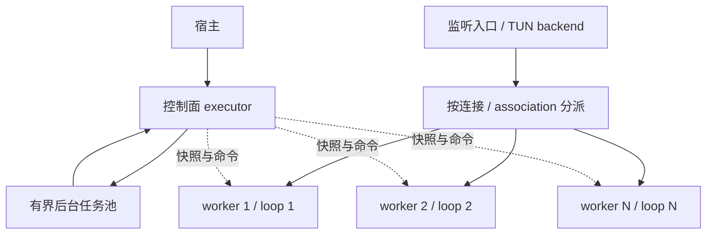

# 运行时、多核与 I/O 所有权

状态：当前开发规范；多 worker 实现与性能测量尚未完成。

## 1. 执行模型

一个 engine 管理 N 个 `solaris_io_worker_t`，每个 worker 一个 libuv loop。每个连接、UDP association、TLS/QUIC/AnyTLS session 固定归属一个 owner executor，不同 owner 并行执行。

libuv 支持多个线程分别运行 loop；其全局线程池主要服务文件、系统 DNS 和显式 work，不会自动并行网络回调里的加解密。SDK 不通过修改 `UV_THREADPOOL_SIZE` 代替数据面设计。[libuv 线程模型](https://docs.libuv.org/en/v1.x/design.html)、[线程池](https://docs.libuv.org/en/v1.x/threadpool.html)

控制面可以独立运行，也可绑定指定 worker，但耗时编译和阻塞任务必须交后台执行。worker 数是宿主运行参数；支持单 worker 和显式 N，自动策略通过平台测量确定。

## 2. 状态与分派

| 对象 | 所有权规则 |
| --- | --- |
| TCP 连接 | 创建时分配 worker，路由/协议/出站尽量留在该 owner |
| UDP association | 按 association key 分配，多个目的报文不能按五元组分到不同 worker |
| TLS/QUIC/Mux session | 全部子流由一个 session owner 操作；跨 worker 使用消息桥 |
| 配置、路由、Geo 编译结果 | 不可变共享快照，引用存续到使用者完成 |
| 协议实例、序号、重放窗口、临时匹配上下文 | 明确的 worker/service 私有可变状态 |
| selector 与健康结果 | 控制面发布一致视图，不能每个 worker 各自解释选择状态 |
| 需要全局语义的策略计数 | 单独协调，不能无意变成 N 套轮询 |
| 统计、pool 与预算 | worker 本地聚合/分层预留；限制总量，不将池上限乘以 N |

活动对象不随意迁移 worker。worker 数改变需要排空、代际映射或显式重建，不能直接改变存量关联的 `hash % N`。

监听器使用平台支持的分流或明确的 accept/handoff backend 转移新连接所有权；禁止跨线程操作活跃 libuv handle。UDP 的内核分流结果仍需核对 association owner。

单条大流或单个共享 session 仍可能受其 owner 限制。多 worker 主要并行不同连接/关联；不预设单流获得 N 倍吞吐。

## 3. 消息与异步任务

跨线程使用有界 mailbox，传递命令和 owned buffer 引用，目标 owner 执行实际操作。队列自行保证同步，`uv_async_send()` 仅用于唤醒；通知可能合并，不能按回调次数计消息。[官方说明](https://docs.libuv.org/en/v1.x/async.html)

每轮处理有工作预算，剩余消息按无丢唤醒的协议再次调度。控制/释放消息保留容量，数据背压不能阻断停止和回收。

配置、文件和索引准备进入有界后台任务。任务携带输入、输出、取消令牌和 generation，不能直接修改 owner 对象；迟到结果由 owner 检查后交付或清理。

加解密首先随连接分散到 I/O workers。仅 profiling 证明收益时才给独立计算增加 CPU executor；nonce、重放状态和有序提交仍由 owner 管理。禁止任意并发使用同一个 SSL/协议对象，不能默认每个小包都跨线程投递。

## 4. I/O 完成与 buffer 契约

- open/write/send 返回 `SOLARIS_OK` 表示接受请求，稍后恰好一次完成；返回错误表示拒绝且没有完成回调，不混用同步/异步完成。
- 内部写入持有不可变 buffer slice 引用；接受即 retain，完成释放，拒绝不持有。宿主入口可 copy-in，内部层间不强制重复复制。
- stream 按有界 chunk 接受；满队列返回 `SOLARIS_EAGAIN` 且零接受，提供 writable 通知；read pause/resume 传播到下层。
- datagram 不部分接纳一个消息；批量可以接受有序前缀，必须准确报告 accepted 数并管理每个已接受 buffer。
- open 完成表示协议允许使用返回对象，不等于业务目标健康；认证状态在可确定时独立报告。
- 半关闭与整体关闭分离，支持时先排空写队列再 FIN；不支持时由明确能力和 relay 策略处理。

## 5. 取消与关闭

对象状态至少包含 closing/closed，关闭幂等。作用域持有 child task、连接和引用；拒绝新任务、取消/排空已有任务、完成关闭屏障后，引用归零才 destroy。

engine 停止先关闭 admission/分派，再通知各 owner，取消后台任务，排空完成与释放消息，等待各 worker 屏障，最后回收线程和宿主相关引用。旧 generation 回调不能操作新对象；不能从回调线程阻塞等待自身退出。

## 6. TUN 栈边界

原 lwIP 使用 `NO_SYS=1` 和全局状态，不能直接给多个 worker 并发操作。首个 backend 如果复用这套 lwIP，由 stack executor 串行拥有 TCP 状态，向出站 worker 交付有序数据，结果再回栈；UDP 使用独立 association 分派路径。

这能并行出站与加解密，但栈、入口分派和回复写入仍可能限速。增加全局锁不构成并行栈。真正的可分片 backend 需要证明实例/队列与状态隔离，并声明宿主 packet callback 的线程与批次所有权约束。

TUN backend 的首选实现和串行/并行能力在 M0 调查并记录，接口保持可替换；M1 即测试多 worker 分派，不能把多核所有权留到 M6。

## 7. 验证

M1 至少两个 I/O worker 验证 TCP/UDP 分派、会话固定、消息背压、取消、关闭、代际更新和不重复完成。后续在同条件下比较 1/2/4 workers 的 CPU、吞吐/包率、尾延迟、loop lag、队列、丢包、RSS 和能耗。

需要分别测多连接、单大流、多 association、单 association 和单共享 session。测量与完成标准见 [测试规范](TESTING.md)。源码核对记录见 [历史运行时草案](../archive/2026-11-03/RUNTIME_CONCURRENCY_DESIGN.md)。
