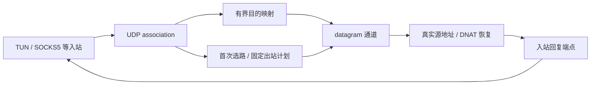

# UDP association 与 NAT

状态：当前开发规范；新实现尚未完成。源码核对与原实现探针见 [历史调查](../archive/2026-11-03/UDP_NAT_DESIGN.md)。

## 1. 模型与术语

| 对象 | 职责 |
| --- | --- |
| `solaris_udp_association_t` | 客户端身份、owner、队列、状态、固定 plan、超时与子通道 |
| `solaris_udp_mapping_t` | 原始目标、域名、实际端点、Fake-IP 租约和回复恢复关系 |
| `solaris_datagram_t` | adapter 提供的 native UDP/UoT/XUDP/QUIC 等通道 |
| `solaris_udp_reply_endpoint_t` | 将 payload 与客户端应见的源地址写回入站，管理引用与关闭 |

五元组用于目的子流、计数和追踪，不自动等同于独占 socket。入站只处理自身协议格式，UoT/XUDP framing 属于 outbound/shared codec。

## 2. 身份与固定选路

association key 使用规范化二进制字段：`engine + inbound 实例/代际 + 客户端或 association 身份 + 源地址族/IP/端口`。

TUN 按命名空间内的源端点；SOCKS5 按 UDP ASSOCIATE 控制连接及已确认客户端源端点；具有连接 ID 的入站使用自己的逻辑身份。不同入站的同源地址不能串会话，客户端端口变化按入站协议处理。

与所核对的 mihomo 通用 UDP 行为对齐，首次有效报文完成必要的 sniff/预处理后固定路由和最终节点。后续目的地分别解析/映射，复用同一个 plan；不默认逐目的地址重选策略。规则、节点与 Provider 更新影响新 association，存量通过明确的关闭/网络失效操作结束。

例如，同一个 association 首次目的 A 匹配 Direct，后续目的 B 即使单独匹配时会走 Proxy，仍沿用该 association 的 Direct。该行为必须进入兼容测试；若未来提供逐目的选路，应是显式扩展。

整个 association 固定一个 I/O worker。目的地改变不改变 worker、owner 或绑定；规则的 UDP 能力过滤与实际 open 使用同一 plan。

## 3. 通道复用、映射与过滤

同族的 Direct 多目的报文复用一个本地 UDP socket。IPv4/IPv6 可有各自 transport lane，不要求跨族保持同一物理映射。单目的协议可建立目的子通道，但要报告多目的稳定映射限制；远端代理服务器是否复用端口不能由本地能力保证。

映射模式与过滤分别定义。endpoint-independent mapping 表示可复用范围内跨目标共用绑定；destination-dependent 模式可将目的纳入复用键。过滤决定接收哪些远端源地址/端口，不能从是否复用 socket 推导。

默认 mihomo 对齐路径使用 association 复用。`endpoint-independent-nat: true` 请求对应能力，无法提供时明确报错；`false` 采用 backend 默认行为，不强制五元组独占 socket。实际模式和限制可查询，并用测试验证。

普通回复保留真实 peer，允许协议/策略支持的备用远端地址与端口；只有已建立的 DNAT 关系才进行地址恢复。不能把所有回包强制改成首包目的地，也不能为适配五元组而静默丢弃合法备用来源。

## 4. DNS、Fake-IP 与回复恢复

发送记录原始目标与实际目标；回复端口来自实际 peer 或明确的端口转换关系。映射按 association、地址族、端点及通道上下文区分。

Fake-IP 租约在关联活跃期间不能回收给别的域名。多个原目标映射到同一实际端点，无法唯一恢复时，在发送前使用隔离子通道并报告映射能力限制；资源不足明确失败，不用最近一次解析结果猜测归属。

目的解析异步执行并合并适当请求，限制待解析目标数。未解析的首部报文可按约定维持 association 发送顺序，但有明确的 deadline、队列预算与丢弃策略，不能阻塞 I/O loop。

回复端点可随入站有效状态更新，但必须持有引用并核对代际，不能向已关闭或被替换的宿主通道写入。

## 5. 状态、预算与超时

状态机：`NEW → RESOLVING/SNIFFING → OPENING → ACTIVE → CLOSING → DEAD`。首次接纳后先登记 OPENING，后续包合并排队，不重复建通道。

- 分别限制 association 数、每关联目的条目、待解析目标、排队包数/字节数和全局内存预算。
- DNS、sniff、open 各有 deadline；idle 超时只管理有效存续的 association。
- `tun.udp-timeout` 按秒作用于实际 TUN UDP association，默认 300 秒；显式覆盖应可观察。
- 成功接纳/发送及符合策略的合法接收可刷新 idle；无效包、队列满和失败尝试不能无限延长状态。
- 队列满丢包并计数，不因单次突发关闭整个可复用通道。EAGAIN 使用有界等待/丢弃，帧式 UDP 必须完整接纳 framing，不能重放已经部分写出的帧。
- SOCKS5 控制连接关闭时终止相关 association；TUN 使用 idle、显式关闭和网络事件。
- 关闭停止 admission，取消解析/握手，排空或释放队列与子通道，释放映射租约。删除表条目核对 ID/generation，旧回调不能删除同 key 的新对象。
- 回收用有工作预算的 deadline 队列或时间轮；具体实现以负载测量确定。

对照基准有通用 tunnel 固定 60 秒与 TUN 默认 300 秒分层不一致的现象，且固定 sing-tun 版本未发现读取 EIM 开关。Solaris 按上述明确契约实现和报告，不复制无效参数；差异登记为刻意修正，而非声称逐位复制基准。

## 6. 报文正确性与性能

共享 IPv4/IPv6 UDP codec 处理长度、校验和、扩展头策略、MTU、超长报文和明确的分片能力。首版未支持的分片必须有能力说明和丢弃计数，不能静默宣称完整支持。

合法零长度 payload 必须可收发，区别于底层没有来源地址的空事件。native 数据报保持消息边界；UoT/XUDP 在模块内完成流式重组。

保留有意义的批量收发、输入批次借用、有限 pool 与预算回退。异步排队使用 owned buffer，不能借用即将复用的 ingress 内存。批次可包含同一通道的不同目的地址，accepted 前缀与 buffer 引用一一对应；优化不改变选路、顺序或回复恢复。

## 7. 必需验收

同源 A/B/A 的本地端口复用；不同入站同源隔离；首包选路与反向顺序；OPENING 多包竞争；异构 UDP 封装；Fake-IP 歧义；备用源地址/端口；空报文与 IPv6；关闭/超时/网络变化竞争；普通与批量发送一致性。用例定义和证据要求见 [测试规范](TESTING.md)。

实现从 M1 的 association/Direct 开始，在 M3 完成双栈 TUN、DNS 与 Fake-IP 接入。它不继承原实现的五元组 socket 模型或原私有配置格式。

依据：[mihomo UDP sender](https://github.com/Herta-Network/mihomo/blob/9f121787bb563fe655d2789cbf6dbcc7ae19a0c9/tunnel/connection.go)、[UDP 编排](https://github.com/Herta-Network/mihomo/blob/9f121787bb563fe655d2789cbf6dbcc7ae19a0c9/tunnel/tunnel.go)、[RFC 4787](https://www.rfc-editor.org/rfc/rfc4787.html)、[TUN 配置](https://wiki.metacubex.one/config/inbound/tun/)。原实现缺口和本地探针不作为新代码已经实现的证据。
